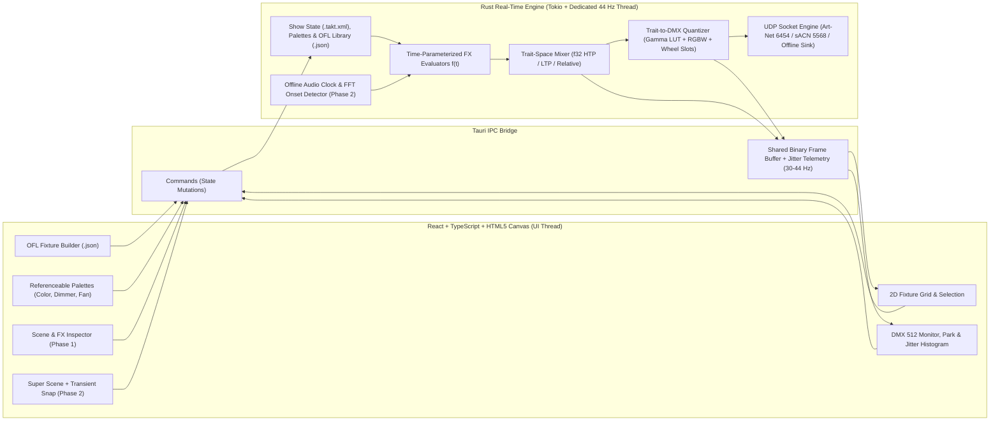

# TaktLight: Technical Architecture & Implementation Blueprint

## 1. Executive Summary & Effort Breakdown

**TaktLight** (*Takt* = musical beat/measure + deterministic clock cycle) is a 100% offline-capable, Ethernet-native DMX lighting control and show design application built with **Tauri v2 (Rust + React/TypeScript)**. By targeting **Art-Net v4** and **sACN (ANSI E1.31)** exclusively over Ethernet, deferring moving-head mechanics (`Pan/Tilt`/Gobos) to Phase 3, and skipping heavy 3D visualizers, TaktLight focuses on rock-steady **44 Hz** LED, pixel-bar, tube, par, and strobe control.

| Phase | Milestone | Estimated Effort | Core Deliverable |
| :--- | :--- | :--- | :--- |
| **M1** | **Rust Core, Network Engine & Jitter Telemetry** | **10 to 15 hrs** | 44 Hz deterministic loop (works 100% offline/no-NIC), Art-Net v4 & sACN output, Live 512ch DMX Monitor, Channel Park & $\mu\text{s}$ Jitter Histogram |
| **M2** | **Native Open Fixture Library (OFL) `.json` & Builder UI** | **12 to 18 hrs** | Native OFL `.json` parser (`channels`, `matrix`/`pixelGroups`, `ColorIntensity`, `ShutterStrobe`, `WheelSlot`), bundled offline OFL database + in-app Visual Fixture Builder |
| **M3** | **Patching, `.takt.xml` Show File & 2D Grid** | **18 to 25 hrs** | Universe patching, per-fixture Gamma ($\gamma$) & deadzone settings, tuned `.takt.xml` persistence, interactive 2D Fixture Grid with live cell color/dimmer feedback |
| **M4** | **Trait-Space Mixer & Referenceable Palettes** | **15 to 20 hrs** | Normalized `f32` trait pipeline (HTP/LTP/Relative), Referenceable Color & Dimmer Palettes, RGBW/Color-Wheel quantization, Gamma LUT |
| **M5** | **1D & 2D Procedural FX Engine (Phase 1)** | **20 to 30 hrs** | Static fanning, Step Chases, 1D Waveforms (`Sine`, `Triangle`, `Saw`, `Square`, `Pulse`), 2D Spatial Matrix Shaders, Hz & BPM timing |
| **M6** | **Super Scene Timeline & Offline Transient Detection (Phase 2)** | **35 to 45 hrs** | Offline Rust audio playback (`symphonia`/`cpal`), offline FFT spectral-flux transient/kick/snare snap markers, multi-track FX Block timeline |
| **M7** | **Moving-Light Expansion & Stage Calibration (Phase 3 Future)** | **+20 to 25 hrs** | 16-bit `Pan/Tilt` traits, XY Pad, Lissajous motion oscillators, and Per-Fixture Physical Stage Calibration (`invert`, `swap`, `min/max` bounding box) |
| **Total** | **Phase 1 (M1 to M5) + Phase 2 (M6)** | **~75 to 108 hrs (v1) / +40 hrs (v2)** | Complete offline-first studio show designer |

---

## 2. System Architecture (Tauri: Rust + React/TypeScript)

> [!IMPORTANT]
> **Strict Domain Separation & 100% Offline Operation:**
> 1. Never calculate DMX frame values or run effect oscillators inside React/JavaScript. React only edits configuration state and renders the 60 fps UI canvas. Rust owns the 44 Hz real-time clock, evaluates all active scenes and FX at time $t$, merges traits, and transmits UDP packets.
> 2. **Zero Cloud or Active NIC Dependency:** All fixture profiles (bundled OFL `.json` files), audio transient analysis, and 2D grid previews run locally offline. If no Ethernet adapter is plugged in, the Rust engine continues running at `44.0 Hz` in `Offline / Loopback Mode` so shows can be programmed anywhere.



### Recommended Crate & Package Stack

* **Rust Backend (`src-tauri/Cargo.toml`):**
  * `serde`, `serde_json` (Native Open Fixture Library `.json` parsing and authoring)
  * `quick-xml` with `serde` (Tuned `.takt.xml` Show file serialization)
  * `socket2`, `tokio` (Non-blocking UDP sockets, NIC IP binding, broadcast/multicast join, graceful offline fallback)
  * `spin_sleep` (Sub-millisecond accurate `22.72 ms` / 44 Hz frame pacing on Windows + $\Delta t$ jitter telemetry)
  * `parking_lot` (`RwLock` for zero-contention state reads in the 44 Hz loop)
  * *Phase 2 Offline Audio & Transient Detection:* `symphonia` (offline decoding of `.wav`/`.mp3`/`.flac`), `rustfft` (offline spectral-flux kick/snare transient detection and waveform peak generation), and `cpal` (low-latency local audio output)
* **React Frontend (`package.json`):**
  * `zustand` (UI state store synced with Rust backend)
  * `HTML5 Canvas 2D` (for the 2D Fixture Grid, live jitter histogram, and Phase 2 Super Scene waveform/timeline)
  * `lucide-react` + `tailwindcss` configured with the **Another German Engineer (AGE) Design System V1.0** color palette and typography (`DM Sans` + `Fira Code`)

---

## 2.1 UI Design System (AGE Design Guide V1.0)

TaktLight's studio interface strictly follows the **Another German Engineer Design System V1.0** so the software UI visually matches the channel's hardware diagrams, code overlays, and Manim animations.

### Color Palette Tokens

| Token | Hex | UI Role in TaktLight |
| :--- | :--- | :--- |
| **`VOID`** | `#0A0F18` | 2D Fixture Grid canvas background & outer workspace frame |
| **`PITCH`** | `#0D1117` | Deepest inset backgrounds (Super Scene track lanes, 512ch DMX Monitor cells, JSON/XML preview) |
| **`SLATE_DARK`** | `#111827` | Primary application background & main docking shell |
| **`INK`** | `#1A2030` | Input fields, fader tracks, metric badges, and inactive scene buttons |
| **`SLATE`** | `#1A2535` | Inspector cards, modals, Fixture Builder panels, and FX Block bodies |
| **`STEEL`** | `#4A5A6A` | `1px` panel hairlines, card borders (`rounded-[10px]`), and 2D canvas grid lines |
| **`FOG`** | `#8898A8` | Secondary labels, DMX channel indices (`001..512`), and inactive tab text |
| **`MIST`** | `#E8EEF6` | Primary UI text, active fixture names, and parameter values |
| **`FROST`** | `#F2F6FB` | High-contrast cursor/handle highlights |
| **`EMBER`** | `#FF5500` | Primary hot accent: selected fixture ring, active fader fill, timeline playhead, and header accent bars |
| **`BURNT`** | `#D94400` | Hover/pressed state for `EMBER` interactive controls |
| **`COBALT`** | `#2255AA` | 1D/2D oscillator wave curves, sACN universe badges, and audio waveform body |
| **`PLUM`** | `#8833AA` | BPM / beat-grid markers, audio transient snap lines, and phase-offset (`0°..360°`) indicators |
| **`PINE`** | `#1E6B35` | Network output healthy (`44.0 Hz`), ArtPoll node online, and valid patch state |
| **`SIGNAL`** | `#CC0000` | Blackout active, Channel Park override warning, and DMX address collision alert |

### Typography & Component Styling

* **Primary UI Font (`FONT_SANS`):** `DM Sans` (`400` regular for body, `500` medium for labels, `600` semibold for panel headers).
* **Technical / Monospace Font (`FONT_CODE`):** `Fira Code` for all numerical metrics, DMX addresses (`U1.001`), raw `0..255` / `0x00..0xFF` values, IP addresses, frame rate & jitter (`44.0 Hz | ±0.03 ms`), and timeline timecode (`00:01:24.50`).
* **Card & Header Pattern:** Panels use `SLATE` (`#1A2535`) fill with a `1.5px` `STEEL` (`#4A5A6A`) border, `10px` corner radius, an uppercase `Fira Code` category tag in `FOG` (`#8898A8`), a `DM Sans` title in `MIST` (`#E8EEF6`), and a short `EMBER` (`#FF5500`) accent rule underneath.

---

## 3. Data Schemas

### 3.1 Native Open Fixture Library (OFL) Schema (`.json`)

Instead of inventing a proprietary fixture format, TaktLight uses the **Open Fixture Library (OFL) JSON schema** directly for both **importing community fixtures offline** and **creating custom fixtures in the in-app Fixture Builder**:
* **Multi-Cell / Pixel Bar Support:** OFL natively defines `matrix.pixelCount` / `pixelKeys` and `templateChannels` (`Red $pixelKey`, `Green $pixelKey`, `Blue $pixelKey`, `White $pixelKey`) along with `repeatFor` inside `modes`.
* **Color Wheels & Shutter Capabilities:** OFL natively defines `wheels` (`WheelSlot` colors) and channel `capabilities` (`Intensity`, `ColorIntensity`, `ShutterStrobe`, `WheelSlot`, `NoFunction`).

```json
{
  "$schema": "https://raw.githubusercontent.com/OpenLightingProject/open-fixture-library/master/schemas/fixture.json",
  "name": "RLCV3 8-Segment RGBW Tube",
  "shortName": "RLCV3-8Px",
  "categories": ["Pixel Bar", "Color Changer"],
  "matrix": {
    "pixelCount": [8, 1, 1],
    "pixelGroups": {
      "All": "all"
    }
  },
  "availableChannels": {
    "Master Dimmer": {
      "defaultValue": 0,
      "capability": { "type": "Intensity" }
    },
    "Strobe": {
      "defaultValue": 0,
      "capabilities": [
        { "dmxRange": [0, 7], "type": "ShutterStrobe", "shutterEffect": "Closed" },
        { "dmxRange": [8, 15], "type": "ShutterStrobe", "shutterEffect": "Open" },
        { "dmxRange": [16, 200], "type": "ShutterStrobe", "shutterEffect": "Strobe", "speedStart": "1Hz", "speedEnd": "20Hz" },
        { "dmxRange": [201, 255], "type": "ShutterStrobe", "shutterEffect": "Random" }
      ]
    }
  },
  "templateChannels": {
    "Red $pixelKey": {
      "defaultValue": 0,
      "capability": { "type": "ColorIntensity", "color": "Red" }
    },
    "Green $pixelKey": {
      "defaultValue": 0,
      "capability": { "type": "ColorIntensity", "color": "Green" }
    },
    "Blue $pixelKey": {
      "defaultValue": 0,
      "capability": { "type": "ColorIntensity", "color": "Blue" }
    },
    "White $pixelKey": {
      "defaultValue": 0,
      "capability": { "type": "ColorIntensity", "color": "White" }
    }
  },
  "modes": [
    {
      "name": "34ch Pixel Mode",
      "shortName": "34ch",
      "channels": [
        "Master Dimmer",
        "Strobe",
        {
          "insert": "matrixChannels",
          "repeatFor": "eachPixelABC",
          "channelOrder": "perPixel",
          "templateChannels": [
            "Red $pixelKey",
            "Green $pixelKey",
            "Blue $pixelKey",
            "White $pixelKey"
          ]
        }
      ]
    }
  ]
}
```

---

### 3.2 Tuned Project / Show File Schema (`.takt.xml`)

Using XML (`.takt.xml`) for the show file keeps hierarchical timeline tracks, referenceable palettes, per-fixture gamma/deadzone calibration, and human-readable diffs clean. Notice how `<FxBlock>` is identical whether inside a Phase 1 `<Scene>` or a Phase 2 `<SuperScene>` track.

```xml
<?xml version="1.0" encoding="UTF-8"?>
<TaktLightShow version="1.0" name="Studio Lightshow" bpm="128.0">
  
  <NetworkOutputs frame_rate_hz="44" bind_ip="0.0.0.0" offline_fallback="true">
    <Universe id="1" protocol="artnet" mode="unicast" target_ip="192.168.1.50" net="0" subnet="0" uni="0" artsync="true" />
    <Universe id="2" protocol="sacn" mode="multicast" sacn_universe="2" priority="100" />
  </NetworkOutputs>

  <Palettes>
    <ColorPalette id="pal_cyber" name="Cyberpunk Dual" hex_start="#FF5500" hex_end="#2255AA" />
    <ColorPalette id="pal_warm" name="Warm Tungsten" hex_start="#FFAA44" hex_end="#FF8822" />
    <DimmerPalette id="dim_half" name="Studio 60%" value_start="0.60" value_end="0.60" />
  </Palettes>

  <Patch>
    <FixtureInstance id="fx_201" profile="age/rlcv3_8_segment_tube.json" mode="34ch Pixel Mode" name="Tube Left" universe="1" address="1">
      <!-- Automatically expands to fx_201:0 through fx_201:7 on the 2D grid -->
      <GridPos x="0.25" y="0.20" rotation="90.0" scale_x="0.30" />
      <!-- Feature 1C: Per-fixture Gamma & Minimum Dimmer Deadzone Compensation -->
      <Calibration gamma="2.2" min_dimmer_dmx="4" max_dimmer_dmx="255" />
      <!-- Phase 3 Future Reserve (Feature 1A): Stage Bounding Box for Moving Lights -->
      <!-- <StageBounds invert_pan="false" invert_tilt="true" swap_pan_tilt="false" pan_range="0.15..0.85" tilt_range="0.10..0.60" /> -->
    </FixtureInstance>
  </Patch>

  <Groups>
    <Group id="grp_tubes_cells" name="All Tube Pixels" order="symmetrical_center_out">
      <Target ref="fx_201:0..7" />
    </Group>
  </Groups>

  <!-- PHASE 1: Standard Scenes (Looping / Triggered) -->
  <Scenes>
    <Scene id="sc_cyber_wave" name="Cyberpunk Sine Wave" blend_mode="ltp" loop_beats="4.0">
      <FxBlock id="blk_1" target_group="grp_tubes_cells" start_beat="0.0" duration_beats="4.0">
        <!-- Feature 1B: Referenceable Palette IDs -->
        <StaticTrait trait="dimmer" mode="htp" palette_ref="dim_half" />
        <StaticTrait trait="color" mode="ltp" palette_ref="pal_cyber" fan="mirror" />
        <Curve1D trait="dimmer" mode="relative" waveform="sine" amplitude="0.40" offset="0.0" rate_beats="2.0" phase_spread_deg="360.0" order="symmetrical_center_out" />
      </FxBlock>
    </Scene>
  </Scenes>

  <!-- PHASE 2: Super Scenes (Audio-Synced Multi-Track Timeline with Offline Transient Snap) -->
  <SuperScenes>
    <SuperScene id="ss_intro" name="Intro Timecode Track" bpm="128.0" duration_sec="95.4">
      <AudioTrack file="audio/intro_mix.wav" offset_sec="0.0" transient_sensitivity="0.65" />
      <Track id="trk_1" name="Tube Base &amp; Pulse" target_group="grp_tubes_cells">
        <Clip ref_block="blk_1" start_sec="4.500" duration_sec="15.000" fade_in_sec="1.200" fade_out_sec="0.500" />
      </Track>
      <Track id="trk_2" name="Matrix Sweep" target_group="grp_tubes_cells">
        <Clip start_sec="12.000" duration_sec="8.000" fade_in_sec="0.0" fade_out_sec="1.0">
          <SpatialShader2D shader="radial_wave" palette_ref="pal_cyber" speed_hz="1.5" direction_deg="45.0" />
        </Clip>
      </Track>
    </SuperScene>
  </SuperScenes>

</TaktLightShow>
```

---

## 4. The 4-Stage Real-Time Pipeline (44 Hz in Rust)

To prevent timing jitter and make every effect work across any fixture type, the Rust engine runs a dedicated thread ticking every `22.72 ms` (`44 Hz`):

### Stage 1: Time, Palette & Phase Resolution
For every active `Scene` (or active `SuperScene` playhead at time $t_{\text{sec}}$):
1. Convert $t_{\text{sec}}$ into beat position $b = t_{\text{sec}} \times \frac{\text{BPM}}{60}$.
2. Resolve any `palette_ref` IDs (`<ColorPalette>`, `<DimmerPalette>`, and future `<PositionPalette>`) against the `<Palettes>` table so live palette edits take effect on the very next 44 Hz tick.
3. For each targeted sub-fixture cell $i \in \{0 \dots N-1\}$ in the selection group:
   * **1D Ordering:** Compute normalized index $u_i \in [0, 1]$ based on the group's ordering rule (`Linear`, `Reverse`, `Center-Out Symmetrical`, `Odd/Even`, `Blocks of K`).
   * **2D Spatial Mapping:** Read the cell's normalized canvas coordinates $(x_i, y_i) \in [0, 1]^2$.

### Stage 2: Pure Function FX Evaluation
Every FX generator outputs a `CellTraitDelta` struct for cell $i$ at beat $b$:
* **Static / Fanning:** Linearly interpolates between `start` and `end` (or resolved palette endpoints) across $u_i$:
  $$V(i) = V_{\text{start}} + u_i \cdot (V_{\text{end}} - V_{\text{start}})$$
* **1D Curve Oscillator:** Evaluates waveform $W(\phi)$ (`Sine`, `Triangle`, `Saw`, `Square`, `Pulse`) at phase:
  $$\phi_i(b) = \left(\frac{b}{\text{rate\_beats}} + u_i \cdot \frac{\theta_{\text{spread}}}{360^\circ}\right) \bmod 1.0$$
* **2D Spatial Shader:** Evaluates 2D procedural function $S(x_i, y_i, b)$ (for example, signed distance from a rotating line or expanding ring mapped to a color palette).

### Stage 3: Trait-Space Mixer (`f32` Accumulation)
Each sub-fixture cell holds an accumulator in normalized `f32` trait space before touching any DMX byte:
* `dimmer: f32` (`0.0..=1.0`): Merged via **HTP (`max`)** for base layers, plus **Relative (`+` / `*`)** for dimmer pulse/chase overlays, multiplied by the Scene/Clip fade envelope and Master Dimmer.
* `color_rgb: [f32; 3]` (`0.0..=1.0`): Merged via **LTP crossfade** (weighted by clip fade-in/out alpha) or **Additive (`max`)**.
* `shutter_strobe: ShutterState`: `Open`, `Closed`, `StrobeHz(f32)`, or `RandomStrobe(f32)`.
* *(Reserved for Phase 3 Moving Lights)* `pan_tilt: [f32; 2]` (`0.0..=1.0` base + `-1.0..=1.0` relative offset).

### Stage 4: Hardware Trait-to-DMX Quantizer, Gamma LUT & Park Override
For each patched fixture and its sub-cells, map the resolved `CellTraitState` to raw universe bytes `u8[512]`:
1. **Per-Fixture Gamma Curve ($\gamma$) & Deadzone Compensation (Feature 1C):**
   * For any non-zero normalized intensity $v \in (0.0, 1.0]$, apply perceptual gamma correction and map into the fixture's calibrated `[min_dimmer_dmx, max_dimmer_dmx]` range:
     $$D_{\text{out}} = \text{round}\left(D_{\text{min}} + v^{\gamma} \cdot (D_{\text{max}} - D_{\text{min}})\right)$$
2. **Color Translation:**
   * If the cell has `ColorIntensity` (`Red`, `Green`, `Blue`, `White`) channels: extract white component $W = \min(R, G, B)$ (if `White` exists), apply Virtual Dimmer if the cell has no dedicated `Intensity` channel, and apply the fixture's Gamma LUT.
   * If the fixture only has a `WheelSlot` color wheel channel: find the color slot in the OFL `.json` with the minimum Euclidean distance in perceptual RGB/OKLAB space and output the midpoint DMX byte of that slot's `dmxRange`.
3. **Phase 3 Reserve (Feature 1A Stage Bounds & 16-Bit Quantization):**
   * When moving-light traits (`Pan/Tilt`) are enabled in Phase 3, apply `<StageBounds>` (`invert`, `swap`, `min..max` scaling) before splitting `0.0..=1.0` into 16-bit Coarse (`>> 8`) and Fine (`& 0xFF`) DMX bytes.
4. **Channel Park Override:**
   * Apply any parked/locked test channels from the **DMX Monitor** last so hardware debugging overrides everything.

---

## 5. Ethernet Protocol Specs & 44 Hz Jitter Telemetry (Feature 3H)

Both protocols are constructed directly in fixed stack arrays without external DMX crates:

* **Art-Net v4 (`UDP 6454`):**
  * `ArtDmx` (`OpCode 0x5000`, little-endian): 18-byte header + 512 bytes payload = **530 bytes**.
  * `ArtSync` (`OpCode 0x5200`): 14-byte packet broadcast after all universe `ArtDmx` packets are sent in a tick to lock multi-universe frame flips.
  * `ArtPoll` (`OpCode 0x2000`) / `ArtPollReply` (`OpCode 0x2100`): Broadcast every 2.5 seconds when an active NIC is present.
* **sACN / ANSI E1.31 (`UDP 5568`):**
  * 126-byte Root + Framing + DMP header + 512 bytes DMX payload = **638 bytes**; Multicast IP for Universe $U$ is `239.255.(U >> 8).(U & 0xFF)`.
* **Live 44 Hz Frame-Time & Jitter Histogram (Feature 3H):**
  * The Rust `spin_sleep` loop records a rolling 256-frame ring buffer of actual inter-frame intervals $\Delta t_k$ (target `22,727 µs`) and computes `mean_us`, `max_jitter_us`, and `dropped_frames`.
  * Displayed continuously in the status bar (`44.0 Hz | 22.73 ms ± 0.04 ms`) and expandable into a live histogram inside the DMX Monitor.

---

## 6. Offline Audio Transient & Beat-Grid Detection (Feature 2D)

When an audio file (`.wav`, `.mp3`, `.flac`) is loaded into a Phase 2 **Super Scene**, Rust runs a 100% offline analysis pass (`symphonia` + `rustfft`, completing a 4-minute song in `<150 ms`):
1. **Multi-Band Spectral Flux Onset Detection:** Computes short-time Fourier transforms (STFT, 1024-sample Hann window, 256-sample hop) and measures positive spectral flux across two sub-bands:
   * **Low Band (`40 Hz to 140 Hz`):** Detects kick drums and bass drops.
   * **Mid/High Band (`1.5 kHz to 8 kHz`):** Detects snare hits, claps, and hi-hat transients.
2. **Adaptive Peak Picking & Magnetic Snap Markers:** Applies a rolling median threshold to extract timestamped transient markers (`TransientMarker { time_sec: f32, band: Kick | Snare, strength: f32 }`) cached alongside the downsampled min/max waveform peaks.
3. **Timeline UI Integration:** Renders transient markers in `PLUM` (`#8833AA`) on the audio track so dragging or resizing any `<Clip>` magnetically snaps to drum hits or BPM grid lines offline.

---

## 7. Test-Driven Development (TDD) Mandate & Test Architecture

> [!IMPORTANT]
> **Strict TDD Rule (`Red -> Green -> Refactor`):** Every feature across both the Rust engine and TypeScript frontend must be developed test-first. No feature slice is complete until its unit test suite passes (`cargo test --workspace` and `npm run test`).

### 7.1 Decoupling the Engine for 100% Unit Testability

1. **Pure Core Library (`taktlight-engine`):** All domain logic (OFL `.json` parser, `.takt.xml` serializer, palette resolver, 2D spatial indexing, FX math, Trait-Space Mixer, Gamma LUT quantizer, offline FFT transient detector, and UDP packet builders) lives in pure Rust modules with zero Tauri window dependencies.
2. **Deterministic Clock Injection:** Time `t_sec: f64` and `bpm: f32` are passed explicitly into `Engine::evaluate_frame(t_sec)`.
3. **Mock Network Transport (`PacketSink` Trait):** Production uses `UdpSocketSink` (with graceful `OfflineSink` fallback when no network is connected); unit tests use `MockPacketSink` to assert exact packet bytes.

### 7.2 Mandatory Unit Test Coverage Matrix

| Subsystem | Required Unit Tests (`cargo test` / `vitest`) |
| :--- | :--- |
| **1. Protocol Framing & Jitter Stats** | Byte-exact header verification for `ArtDmx` (530B), `ArtSync` (14B), `ArtPollReply`, and `sACN E1.31` (638B); rolling jitter ring-buffer math (`mean_us`, `max_jitter_us`) and offline fallback when NIC is disconnected. |
| **2. Native OFL `.json` Parser & Patch** | Parsing standard OFL fixtures (`availableChannels`, `templateChannels`, `matrix.pixelCount`, `repeatFor: "eachPixelABC"`, `ShutterStrobe`, `WheelSlot`), multi-cell expansion, and universe `> 512` collision rejection. |
| **3. Show `.takt.xml` & Palettes** | XML round-trip serialization (`<TaktLightShow>`), `<Palettes>` reference resolution (`palette_ref`), and live palette mutation propagation. |
| **4. 1D Group Ordering & 2D Grid Math** | Normalized index $u_i \in [0, 1]$ calculation for `Linear`, `Reverse`, `Symmetrical Center Out`, `Mirror`, and `Odd/Even` group orders; 2D bounding-box normalization and rotation transforms. |
| **5. Pure FX Evaluators $f(t)$** | 1D waveforms (`Sine`, `Triangle`, `Saw`, `Square`, `Pulse`) at known phases ($\phi = 0, 0.25, 0.5, 0.75$), phase-spread distribution across $N$ cells, and 2D spatial shader sampling. |
| **6. Trait-Space Mixer (`f32`)** | `HTP` (`max`) dimmer merging, `LTP` crossfade alpha blending, `Relative +/-` dimmer modulation clamping (`0.0..=1.0`), and Master Dimmer scaling. |
| **7. Gamma LUT & Hardware Quantizer** | Per-fixture Gamma curve ($\gamma = 2.2$) and `min_dimmer_dmx` deadzone math, Virtual Dimmer on RGB-only cells, RGBW white extraction, nearest-slot Euclidean color matching on Color Wheels, and Channel Park overrides. |
| **8. Offline Audio Transient Detector** | Synthetic sine + impulse `.wav` buffer tests verifying accurate kick (`80 Hz` burst) and snare (`3 kHz` burst) onset timestamp extraction via `rustfft`. |

---

## 8. Phased Implementation Plan (Vertical TDD Slices)

Each vertical slice follows the strict workflow: **1. Define Types/Contracts -> 2. Write Failing Unit Tests -> 3. Implement Logic -> 4. Verify `cargo test` & `vitest` -> 5. Wire AGE-Themed UI.**

1. **Slice 1 (Scaffold, TDD Harness, Offline-Safe UDP Engine & Jitter Monitor):** Initialize Tauri v2 + `cargo test` + `vitest` + AGE Design System V1.0 Tailwind tokens. Write unit tests for `ArtDmx`, `ArtSync`, `sACN`, jitter statistics, and Channel Park overrides. Build the Rust 44 Hz loop (with offline fallback) and the React **512-Channel DMX Monitor, Park Matrix & Jitter Histogram**.
2. **Slice 2 (Native OFL `.json` Parser, Offline Library & Fixture Builder UI):** Write unit tests for parsing and generating Open Fixture Library `.json` files (including multi-pixel `matrix` expansion and color/shutter capabilities). Bundle an offline starter library of OFL fixtures + custom RLCV3 profiles, and build the React **OFL Fixture Builder UI**.
3. **Slice 3 (Patch Manager, `.takt.xml` Show File, Calibration & 2D Fixture Grid):** Write unit tests for `<TaktLightShow>` XML round-trips, per-fixture Gamma/deadzone settings, and 1D/2D spatial ordering math. Implement the Universe Patch table and interactive **2D Fixture Grid Canvas**.
4. **Slice 4 (Trait-Space Mixer, Referenceable Palettes & Smart Controls):** Write unit tests for HTP/LTP/Relative float mixing, `<Palettes>` resolution, Gamma LUT quantization, Virtual Dimmer, RGBW extraction, and Color-Wheel slot matching. Implement the 4-stage Rust mixer + React **Palette Manager & Smart Controls** + live 2D Grid feedback.
5. **Slice 5 (Scene Manager & 1D/2D FX Engine):** Write deterministic time-stepped unit tests (`evaluate_frame(t)`) for Static/Fanning, Step Chases, 1D Waveforms, and 2D Spatial Shaders under Hz and BPM timing.
6. **Slice 6 (Phase 2: Super Scene Timeline & Offline Transient Detection):** Write unit tests for spectral-flux onset detection (`rustfft`), timecode-to-beat conversion, and clip fade envelopes. Add offline audio playback (`symphonia`/`cpal`), waveform + transient snap-marker rendering, and the multi-track Super Scene timeline.
7. **Slice 7 (Phase 3 Future Expansion: Moving Lights & Stage Calibration):** Add 16-bit `Pan/Tilt` traits, XY Pad, Lissajous motion curves, and **Feature 1A (`<StageBounds>` physical stage calibration)**.
