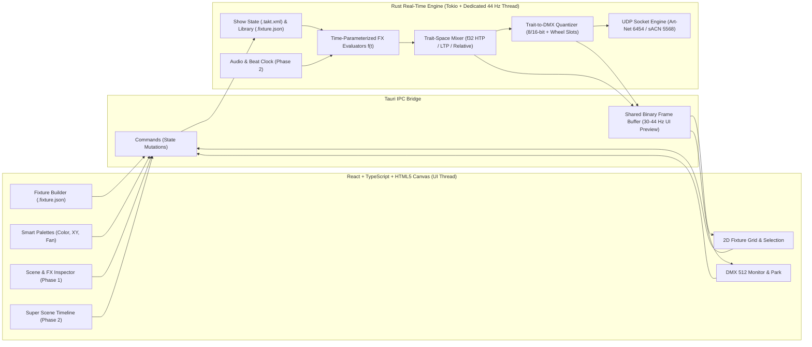

# TaktLight: Technical Architecture & Implementation Blueprint

## 1. Executive Summary & Effort Breakdown

**TaktLight** (*Takt* = musical beat/measure + deterministic clock cycle) is an Ethernet-native DMX lighting control and show design application built with **Tauri v2 (Rust + React/TypeScript)**. By targeting **Art-Net v4** and **sACN (ANSI E1.31)** exclusively over Ethernet and deferring the 3D visualizer and live busking consoles, TaktLight avoids OS USB driver maintenance and 3D shader complexity.

| Phase | Milestone | Estimated Effort | Core Deliverable |
| :--- | :--- | :--- | :--- |
| **M1** | **Rust Core + Network Engine** | **10 to 15 hrs** | 44 Hz deterministic loop, Art-Net v4 (Unicast/Broadcast/ArtPoll/ArtSync) & sACN output, Live 512ch DMX Monitor & Channel Park |
| **M2** | **Fixture `.json` Schema & Builder UI** | **15 to 20 hrs** | Multi-cell Fixture `.json` parser, Color/Gobo Wheel slot definitions, in-app Visual Fixture Builder |
| **M3** | **Patching, `.takt.xml` Show File & 2D Grid** | **20 to 30 hrs** | Universe patching, tuned `.takt.xml` show persistence, interactive 2D Fixture Canvas with live color/dimmer/Pan-Tilt feedback |
| **M4** | **Trait-Space Mixer & Smart Palettes** | **20 to 25 hrs** | Normalized `f32` trait pipeline (HTP/LTP/Relative), Color Picker (auto-quantized to RGBW or Color Wheel), XY Pan/Tilt pad |
| **M5** | **1D & 2D Procedural FX Engine (Phase 1)** | **25 to 35 hrs** | Static fanning, Step Chases, 1D Oscillators (Sine/Circle/Lissajous), 2D Spatial Matrix Shaders, Hz & BPM timing |
| **M6** | **Super Scene Timeline (Phase 2)** | **35 to 50 hrs** | Rust audio playback (`symphonia`/`cpal`), waveform peak rendering, beat-grid markers, multi-track FX Block timeline |
| **Total** | **Phase 1 (M1 to M5) + Phase 2 (M6)** | **~90 to 125 hrs (v1) / +40 hrs (v2)** | Complete Daslight-style studio show designer |

---

## 2. System Architecture (Tauri: Rust + React/TypeScript)

> [!IMPORTANT]
> **Strict Domain Separation:** Never calculate DMX frame values or run effect oscillators inside React/JavaScript. React only edits configuration state and renders the 60 fps UI canvas. Rust owns the 44 Hz real-time clock, evaluates all active scenes and FX at time $t$, merges traits, and transmits UDP packets.



### Recommended Crate & Package Stack

* **Rust Backend (`src-tauri/Cargo.toml`):**
  * `serde`, `serde_json` (Fixture `.fixture.json` serialization)
  * `quick-xml` with `serde` (Tuned `.takt.xml` Show file serialization)
  * `socket2`, `tokio` (Non-blocking UDP sockets, NIC IP binding, broadcast/multicast join)
  * `spin_sleep` (Sub-millisecond accurate `22.72 ms` / 44 Hz frame pacing on Windows)
  * `parking_lot` (`RwLock` for zero-contention state reads in the 44 Hz loop)
  * *Phase 2 Audio:* `symphonia` (decode `.wav`/`.mp3`/`.flac` + generate waveform peaks) and `cpal` or `kira` (low-latency audio output with sample-accurate playback position)
* **React Frontend (`package.json`):**
  * `zustand` (UI state store synced with Rust backend)
  * `HTML5 Canvas 2D` or `pixi.js` (for the 2D Fixture Grid and Phase 2 Super Scene waveform/timeline)
  * `lucide-react` + `tailwindcss` (Dark-mode lighting console UI)

---

## 3. Data Schemas

### 3.1 Reusable Fixture Profile Schema (`.fixture.json`)

Stored in `fixtures/<manufacturer>/<model>.fixture.json`. Supports global channels, 8-bit and 16-bit (`fine_index`) precision, discrete wheel slots (Color Wheels, Gobos, Shutter presets), and multi-cell sub-fixtures (for LED bars and matrices).

```json
{
  "schema_version": 1,
  "manufacturer": "Generic",
  "model": "8-Pixel RGBW Bar + Strobe",
  "category": "led_bar",
  "modes": [
    {
      "name": "34ch Pixel Mode",
      "channel_count": 34,
      "channels": [
        {
          "index": 1,
          "name": "Master Dimmer",
          "trait_type": "dimmer",
          "default_value": 0
        },
        {
          "index": 2,
          "name": "Master Strobe",
          "trait_type": "shutter",
          "default_value": 8,
          "capabilities": [
            { "range": [0, 7], "type": "closed", "label": "Blackout" },
            { "range": [8, 15], "type": "open", "label": "Open" },
            { "range": [16, 200], "type": "strobe_hz", "min_hz": 1.0, "max_hz": 20.0, "label": "Strobe" },
            { "range": [201, 255], "type": "strobe_random", "label": "Random Strobe" }
          ]
        }
      ],
      "cells": {
        "count": 8,
        "layout": { "type": "linear_horizontal", "spacing_mm": 120 },
        "template_channels": [
          { "offset": 0, "name": "Red", "trait_type": "color_r" },
          { "offset": 1, "name": "Green", "trait_type": "color_g" },
          { "offset": 2, "name": "Blue", "trait_type": "color_b" },
          { "offset": 3, "name": "White", "trait_type": "color_w" }
        ],
        "start_channel": 3
      }
    }
  ]
}
```

#### Moving Head Example (16-Bit Pan/Tilt + Mechanical Color Wheel)

```json
{
  "index": 1,
  "fine_index": 2,
  "name": "Pan",
  "trait_type": "pan",
  "deg_range": 540.0,
  "default_value": 32768
},
{
  "index": 5,
  "name": "Color Wheel",
  "trait_type": "color_wheel",
  "default_value": 0,
  "capabilities": [
    { "range": [0, 15], "type": "color_slot", "hex": "#FFFFFF", "label": "Open" },
    { "range": [16, 31], "type": "color_slot", "hex": "#FF0000", "label": "Red" },
    { "range": [32, 47], "type": "color_slot", "hex": "#0055FF", "label": "Deep Blue" },
    { "range": [128, 255], "type": "wheel_rotation", "label": "Rainbow Scroll" }
  ]
}
```

---

### 3.2 Tuned Project / Show File Schema (`.takt.xml`)

Using XML (`.takt.xml`) for the show file keeps hierarchical timeline tracks, compact attribute lists, and human-readable diffs clean. Notice how `<FxBlock>` is identical whether inside a Phase 1 `<Scene>` or a Phase 2 `<SuperScene>` track.

```xml
<?xml version="1.0" encoding="UTF-8"?>
<TaktLightShow version="1.0" name="Mainstage Show" bpm="128.0">
  
  <NetworkOutputs frame_rate_hz="44" bind_ip="192.168.1.10">
    <Universe id="1" protocol="artnet" mode="unicast" target_ip="192.168.1.50" net="0" subnet="0" uni="0" artsync="true" />
    <Universe id="2" protocol="sacn" mode="multicast" sacn_universe="2" priority="100" />
  </NetworkOutputs>

  <Patch>
    <FixtureInstance id="fx_101" profile="generic/moving_spot_16ch.fixture.json" mode="16ch" name="Spot L1" universe="1" address="1">
      <GridPos x="0.20" y="0.15" rotation="0.0" />
    </FixtureInstance>
    <FixtureInstance id="fx_201" profile="generic/8_pixel_rgbw_bar.fixture.json" mode="34ch Pixel Mode" name="Back Bar 1" universe="2" address="1">
      <!-- Automatically expands to fx_201:0 through fx_201:7 on the 2D grid -->
      <GridPos x="0.50" y="0.10" rotation="0.0" scale_x="0.30" />
    </FixtureInstance>
  </Patch>

  <Groups>
    <Group id="grp_spots" name="All Spots" order="symmetrical_center_out">
      <Target ref="fx_101:0" />
    </Group>
    <Group id="grp_bars_cells" name="Pixel Bars (All Cells)" order="left_to_right">
      <Target ref="fx_201:0..7" />
    </Group>
  </Groups>

  <!-- PHASE 1: Standard Scenes (Looping / Triggered) -->
  <Scenes>
    <Scene id="sc_blue_circle" name="Spots Blue Circle" blend_mode="ltp" loop_beats="4.0">
      <FxBlock id="blk_1" target_group="grp_spots" start_beat="0.0" duration_beats="4.0">
        <StaticTrait trait="dimmer" mode="htp" value_start="1.0" value_end="1.0" />
        <StaticTrait trait="color" mode="ltp" hex_start="#0044FF" hex_end="#00FFFF" fan="mirror" />
        <Curve2D trait="pan_tilt" mode="relative" shape="circle" center_x="0.5" center_y="0.3" radius_x="0.15" radius_y="0.10" rate_beats="4.0" phase_spread_deg="180.0" order="symmetrical_center_out" />
      </FxBlock>
    </Scene>
  </Scenes>

  <!-- PHASE 2: Super Scenes (Audio-Synced Multi-Track Timeline) -->
  <SuperScenes>
    <SuperScene id="ss_intro" name="Intro Timecode Track" bpm="128.0" duration_sec="95.4">
      <AudioTrack file="audio/intro_mix.wav" offset_sec="0.0" />
      <Track id="trk_1" name="Spot Base &amp; Moves" target_group="grp_spots">
        <Clip ref_block="blk_1" start_sec="4.500" duration_sec="15.000" fade_in_sec="1.200" fade_out_sec="0.500" />
      </Track>
      <Track id="trk_2" name="Matrix Sweep" target_group="grp_bars_cells">
        <Clip start_sec="12.000" duration_sec="8.000" fade_in_sec="0.0" fade_out_sec="1.0">
          <SpatialShader2D shader="radial_wave" palette="#FF0055,#00FFAA" speed_hz="1.5" direction_deg="45.0" />
        </Clip>
      </Track>
    </SuperScene>
  </SuperScenes>

</TaktLightShow>
```

---

## 4. The 4-Stage Real-Time Pipeline (44 Hz in Rust)

To prevent timing jitter and make every effect work across any fixture type, the Rust engine runs a dedicated thread ticking every `22.72 ms` (`44 Hz`):

### Stage 1: Time & Phase Resolution
For every active `Scene` (or active `SuperScene` playhead at time $t_{\text{sec}}$):
1. Convert $t_{\text{sec}}$ into beat position $b = t_{\text{sec}} \times \frac{\text{BPM}}{60}$.
2. For each targeted sub-fixture cell $i \in \{0 \dots N-1\}$ in the selection group:
   * **1D Ordering:** Compute normalized index $u_i \in [0, 1]$ based on the group's ordering rule (`Linear`, `Reverse`, `Center-Out Symmetrical`, `Odd/Even`, `Blocks of K`).
   * **2D Spatial Mapping:** Read the cell's normalized canvas coordinates $(x_i, y_i) \in [0, 1]^2$.

### Stage 2: Pure Function FX Evaluation
Every FX generator outputs a `CellTraitDelta` struct for cell $i$ at beat $b$:
* **Static / Fanning:** Linearly interpolates between `start` and `end` across $u_i$:
  $$V(i) = V_{\text{start}} + u_i \cdot (V_{\text{end}} - V_{\text{start}})$$
* **1D Curve / Pan-Tilt Oscillator:** Evaluates waveform $W(\phi)$ at phase:
  $$\phi_i(b) = \left(\frac{b}{\text{rate\_beats}} + u_i \cdot \frac{\theta_{\text{spread}}}{360^\circ}\right) \bmod 1.0$$
* **2D Spatial Shader:** Evaluates 2D procedural function $S(x_i, y_i, b)$ (for example, signed distance from a rotating line or expanding ring mapped to a color gradient).

### Stage 3: Trait-Space Mixer (`f32` Accumulation)
Each sub-fixture cell holds an accumulator in normalized `f32` trait space before touching any DMX byte:
* `dimmer: f32` (`0.0..=1.0`): Merged via **HTP (`max`)** for base layers, plus **Relative (`+` / `*`)** for dimmer pulse/chase overlays, multiplied by the Scene/Clip fade envelope and Master Dimmer.
* `color_rgb: [f32; 3]` (`0.0..=1.0`): Merged via **LTP crossfade** (weighted by clip fade-in/out alpha) or **Additive (`max`)**.
* `pan_tilt: [f32; 2]` (`0.0..=1.0` base + `-1.0..=1.0` relative offset): Base position layers merge via **LTP crossfade**; oscillator layers add their relative $(\Delta x, \Delta y)$ offset on top and clamp to `[0.0, 1.0]`.
* `shutter_strobe: ShutterState`: `Open`, `Closed`, `StrobeHz(f32)`, or `RandomStrobe(f32)`.

### Stage 4: Hardware Trait-to-DMX Quantizer & Park Override
For each patched fixture and its sub-cells, map the resolved `CellTraitState` to raw universe bytes `u8[512]`:
1. **Color Translation:**
   * If the cell has `color_r/g/b/w` channels: extract white component $W = \min(R, G, B)$ (if `color_w` exists) and write 8/16-bit values.
   * If the fixture only has a `color_wheel` channel: find the `color_slot` capability in the fixture `.fixture.json` with the minimum Euclidean distance in perceptual RGB/OKLAB space and output the midpoint DMX byte of that slot's `range`.
   * If a cell has RGB channels *but* no dedicated `dimmer` channel (common on raw pixel bars): multiply `color_rgb` by the cell's resolved `dimmer` value (Virtual Dimmer).
2. **16-Bit Pan/Tilt Translation:**
   * Multiply normalized `pan` (`0.0..=1.0`) by `65535`: write `u16 >> 8` to `index` (Coarse) and `u16 & 0xFF` to `fine_index` (Fine).
3. **Channel Park Override:**
   * Apply any parked/locked test channels from the **DMX Monitor** last so hardware debugging overrides everything.

---

## 5. Ethernet Protocol Packet Specs

Both protocols are simple enough that Rust can construct the UDP payloads directly in fixed stack arrays without heavy third-party crates:

* **Art-Net v4 (`UDP 6454`):**
  * `ArtDmx` (`OpCode 0x5000`, little-endian): 18-byte header (`"Art-Net\0"`, `0x00, 0x50`, Protocol `0x00, 0x0e`, Sequence `u8`, Physical `0x00`, `SubUni`, `Net`, Length `0x02, 0x00`) + 512 bytes payload = **530 bytes**.
  * `ArtSync` (`OpCode 0x5200`): 14-byte packet broadcast after all universe `ArtDmx` packets are sent in a tick to lock multi-universe frame flips.
  * `ArtPoll` (`OpCode 0x2000`) / `ArtPollReply` (`OpCode 0x2100`): Broadcast every 2.5 seconds to list discovered nodes (IP, short name, universes) in the UI.
* **sACN / ANSI E1.31 (`UDP 5568`):**
  * 126-byte Root + Framing + DMP header + 512 bytes DMX payload = **638 bytes**.
  * Multicast destination IP for Universe $U$ is automatically `239.255.(U >> 8).(U & 0xFF)`.

---

## 6. Phased Implementation Plan (6 Vertical Slices)

1. **Slice 1 (Scaffold & UDP Engine):** Initialize Tauri v2 (Rust + React/TS). Build the Rust 44 Hz loop, Art-Net v4 + sACN packet senders, ArtPoll discovery list, and the React **512-Channel DMX Monitor & Park Matrix**. Verify output using Wireshark or an Art-Net/sACN node.
2. **Slice 2 (Fixture `.fixture.json` Schema & In-App Builder):** Implement the Rust `FixtureProfile` structs (`serde_json`) and build the React **Fixture Builder UI** to create/edit channels, 16-bit pairs, Color/Shutter capability ranges, and multi-cell layouts.
3. **Slice 3 (Patch Manager, `.takt.xml` Show File & 2D Fixture Grid):** Implement `<TaktLightShow>` XML load/save, Universe Patch table, and the interactive **2D Fixture Grid Canvas** (drag/rotate fixtures and multi-cell bars, lasso selection, 1D selection ordering modes).
4. **Slice 4 (Trait-Space Mixer & Smart Attribute Palettes):** Implement the 4-stage Rust `f32` Trait-Space Mixer (Virtual Dimmer, RGBW extraction, Color-Wheel nearest-slot matching, 16-bit Pan/Tilt) + React **Smart Controls** (Color Picker/Wheel palette, XY Pan/Tilt pad with fanning, Shutter controls) + live color/dot feedback on the 2D Grid.
5. **Slice 5 (Scene Manager & 1D/2D FX Engine):** Implement `FxBlock` evaluators (Static/Fanning, Step Chases, 1D Waveforms & Lissajous Pan/Tilt shapes, and 2D Spatial Shaders sampled on the 2D Grid) with Hz and BPM/Tap-Tempo timing.
6. **Slice 6 (Phase 2: Super Scene Timeline):** Add Rust audio decoding/playback (`symphonia`/`cpal`), waveform peak extraction, and the multi-track React Canvas timeline that schedules the existing `FxBlock` and `Scene` clips against audio timecode.
