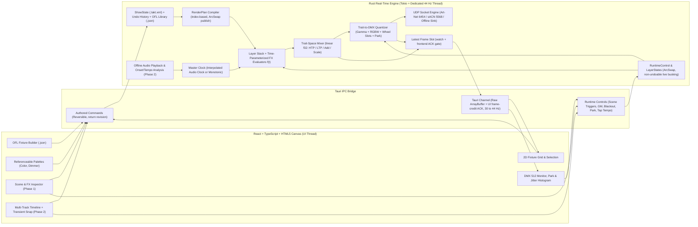

# TaktLight: Technical Architecture & Implementation Blueprint

## 1. Executive Summary & Effort Breakdown

**TaktLight** (*Takt* = musical beat/measure + deterministic clock cycle) is a fully offline-capable, Ethernet-native DMX lighting control and show design application built with **Tauri v2 (Rust + React/TypeScript)**. By targeting **Art-Net v4** and **sACN (ANSI E1.31)** exclusively over Ethernet, deferring moving-head mechanics (`Pan/Tilt`/Gobos) to Phase 3, and skipping heavy 3D visualizers, TaktLight focuses on stable, jitter-monitored **44 Hz** LED, pixel-bar, tube, par, and strobe control.

| Phase | Milestone | Estimated Effort | Core Deliverable |
| :--- | :--- | :--- | :--- |
| **M1** | **Rust Core, Network Engine & Jitter Telemetry** | **12 to 17 hrs** | Absolute-deadline 44 Hz loop (works offline/no-NIC), Art-Net v4 & sACN output (incl. sACN Universe Discovery & Stream Termination), Live 512ch DMX Monitor, Channel Park & $\mu\text{s}$ Jitter Histogram |
| **M2** | **Native Open Fixture Library (OFL) `.json` & Builder UI** | **12 to 18 hrs** | Schema-validated OFL `.json` parser (`channels`, `matrix`/`pixelGroups`, `ColorIntensity`, `ShutterStrobe`, `WheelSlot`), local user OFL import folder (no bundled third-party library) + in-app Visual Fixture Builder |
| **M3** | **Patching, `.takt.xml` Show File, Undo & 2D Grid** | **22 to 30 hrs** | Dual-universe Patch View with overflow roll-over, per-fixture Gamma ($\gamma$), deadzone & white calibration, versioned `.takt.xml` persistence with migrations, Rust-side Undo/Redo & autosave, `RenderPlan` compiler, interactive 2D Fixture Grid with live cell color/dimmer feedback |
| **M4** | **Trait-Space Mixer, Layer Stack & Referenceable Palettes** | **15 to 20 hrs** | Linear-light `f32` trait pipeline (HTP/LTP/Add/Scale), priority Layer Stack, Referenceable Color & Dimmer Palettes, RGBW/Color-Wheel quantization, Gamma |
| **M5** | **1D & 2D Procedural FX Engine (Phase 1)** | **20 to 30 hrs** | Static fanning, Step Chases, 1D Waveforms (`Sine`, `Triangle`, `Saw`, `Square`, `Pulse`), 2D Spatial Matrix Shaders, Hz & BPM timing, Scene priorities & fades |
| **M6** | **Multi-Track Timelines, Audio Clock & Transient Detection (Phase 2)** | **40 to 50 hrs** | Offline Rust audio playback (`symphonia`/`cpal`) as master clock, offline spectral-flux transient/kick/snare snap markers, tempo estimation & beat grid, multi-track FX Clip Timeline |
| **M7** | **Moving-Light Expansion & Stage Calibration (Phase 3 Future)** | **+20 to 25 hrs** | 16-bit `Pan/Tilt` traits, XY Pad, Lissajous motion oscillators, and Per-Fixture Stage Calibration (`invert`, `swap`, `min/max` bounding box) |
| **Total** | **Phase 1 (M1 to M5) + Phase 2 (M6)** | **~81 to 115 hrs (v1) / +45 hrs (v2)** | Complete offline-first studio show designer |

---

## 2. System Architecture (Tauri: Rust + React/TypeScript)

> [!IMPORTANT]
> **Strict Domain Separation & Offline Operation:**
> 1. **Rust computes, React edits:** Never calculate DMX frame values or run effect oscillators inside React/JavaScript. React only edits configuration state and renders the 60 fps UI canvas. Rust owns the 44 Hz real-time clock, evaluates all active layers at time $t$, merges traits, and transmits UDP packets.
> 2. **Rust owns the truth:** The Rust `ShowState` is the single authoritative copy of the show. The `zustand` store is a read mirror that reconciles against a monotonically increasing `revision` number returned by every command. Undo/Redo lives in Rust.
> 3. **Zero Cloud or Active NIC Dependency:** All fixture profiles (user-imported OFL `.json` files), audio transient analysis, and 2D grid previews run locally. If no Ethernet adapter is plugged in, the Rust engine keeps running at `44.0 Hz` in `Offline / Loopback Mode` so shows can be programmed anywhere.
> 4. **One master clock per mode:** When a Timeline plays, time comes from the audio device sample position. Otherwise, time comes from a monotonic system clock. Lights never run on an independent clock from the audio.



### 2.1 Workspace Layout & Recommended Stack

* **Repository & Cargo Workspace Layout:**
  * Root `Cargo.toml` workspace containing `crates/taktlight-engine` (pure Rust core, zero Tauri/window dependencies) and `src-tauri/` (Tauri v2 shell, IPC commands, `Channel` streaming, and OS dialogs).
  * `crates/taktlight-bench` (standalone timing benchmark binary for the 44 Hz loop, see Section 7.3).
  * `src/` for the React/TypeScript frontend (`vite` + `vitest`).
* **Rust Backend (`Cargo.toml`):**
  * `serde`, `serde_json` (Native Open Fixture Library `.json` parsing and authoring)
  * `jsonschema` (Offline validation of imported and Builder-generated fixtures against the official OFL fixture schema and all sibling `$ref` schemas embedded at compile time via `include_str!`)
  * `quick-xml` with `serde` (`.takt.xml` show file serialization; mixed FX child sequences use `$value` enum deserialization, inclusive ascending/descending cell range references such as `fx_201:0..7` or `fx_201:7..0` use a custom parser)
  * `socket2`, `tokio` (Non-blocking UDP sockets bound to the selected adapter IPv4, NIC enumeration, `IP_MULTICAST_IF`, `SO_REUSEADDR` `ArtPollReply` listener, graceful offline fallback)
  * `spin_sleep` (Sub-millisecond accurate absolute-deadline pacing of the `22.727 ms` / 44 Hz frame on Windows + $\Delta t$ jitter telemetry)
  * `arc-swap` (Lock-free publication of the compiled `RenderPlan` and live `RuntimeControl` snapshots to the 44 Hz loop)
  * `sha2` (Content hashes for audio relinking and analysis cache keys)
  * *Phase 2 Offline Audio & Transient Detection:* `symphonia` (streaming offline decoding of `.wav`/`.mp3`/`.flac`), `rubato` (streaming resampling for the low-band analysis path), `rustfft` (spectral-flux transient detection and waveform peak generation), and `cpal` (low-latency local audio output and master clock)
  * *Dev dependencies:* `insta` (golden-frame snapshots), `proptest` (property tests), `cargo-fuzz` (parser fuzzing)
* **React Frontend (`package.json`):**
  * `zustand` (read mirror of the Rust `ShowState`, reconciled by `revision`)
  * `HTML5 Canvas 2D` (for the 2D Fixture Grid, live jitter histogram, and Phase 2 multi-track audio waveform/timeline)
  * `lucide-react` + `tailwindcss` configured with the **Another German Engineer (AGE) Design System V1.0** color palette and locally bundled offline fonts (`@fontsource/dm-sans` + `@fontsource/fira-code`, zero CDN requests)

### 2.2 State Ownership, Undo/Redo, RuntimeControl & RenderPlan

1. **Two-Plane State Split (`ShowState` vs. `RuntimeControl`):**
   * **Authored Show State (`ShowState`):** Patch, palettes, groups, FX blocks, scenes, and timelines. Every authored IPC mutation (`patch_fixture`, `set_palette_color`, `move_clip`, ...) is a reversible `Command` with `apply()` and `revert()` pushed onto a bounded Undo stack (default 500 entries). Continuous gestures (fader drags, color picker scrubs, clip drags) pass a `coalesce_key` so consecutive updates merge into the top Undo entry in place until pointer release.
   * **Ephemeral Runtime State (`RuntimeControl` / `LayerStates`):** Live performance and busking actions (Scene trigger/release timestamps, Grand Master fader, Blackout toggle, tap-tempo phase anchor, Timeline play/pause/seek, and session-only Channel Park overrides) bypass `ShowState` and Undo history. They update an `ArcSwap<RuntimeControl>` snapshot read directly by the 44 Hz thread, avoiding `RenderPlan` recompilation and `.takt.xml` dirty-marking during live operation.
2. **Revision Reconciliation:** Each authored command returns `{ revision: u64, delta }`. If the frontend detects a revision gap, it requests a full state resync.
3. **RenderPlan Compilation:** After every authored command, Rust compiles `ShowState` into an immutable `RenderPlan` and publishes it via `ArcSwap`:
   * Palettes, groups, and FX blocks are resolved to dense integer indices (no string lookups or hash maps in the 44 Hz loop).
   * Group targets such as `fx_201:0..7` (or reversed `fx_201:7..0`) are pre-expanded into cell lists with precomputed 1D index $u_i$ and 2D coordinates $(x_i, y_i)$.
   * Per-fixture DMX channel maps, capability ranges, and calibration constants are pre-baked. Each channel map entry stores its own `(universe, address)` pair, so a split fixture (head in $N$, tail in $N+1$) needs no special case in Stage 4.
   * Live palette edits therefore still take effect on the very next 44 Hz tick.
4. **Autosave & Crash Recovery:** Every 60 seconds and on every 20th authored revision, the current `ShowState` is written to `<show>.takt.xml.autosave`. On launch, a newer autosave than the show file triggers a recovery prompt.

### 2.3 IPC Frame Streaming & Backpressure

* The 44 Hz thread never blocks on IPC. After each tick it writes the frame into a latest-value slot (`tokio::sync::watch`).
* **Raw Binary Transport & Credit Flow Control:** A separate Tokio task forwards the newest frame over the Tauri `Channel` wrapped in `tauri::ipc::InvokeResponseBody::Raw(Vec<u8>)` so it arrives in TypeScript as a zero-copy `ArrayBuffer` rather than a JSON-serialized number array. To prevent unbounded WebView2 message queue growth when the window is minimized or React rendering stalls, the forwarding task waits on both `watch::Receiver::changed()` and a single-slot `AtomicBool` frame credit (`ack_frame`) set by the frontend's `requestAnimationFrame` paint callback. Intermediate frames produced while the UI is busy or hidden are dropped at zero cost.
* **Binary Frame Layout (40-byte 8-byte-aligned header, little-endian):**
  * Header (`40 bytes` total, ordered by alignment so TypeScript `DataView` / typed arrays require zero unaligned reads):
    * `0..8`: `revision: u64`
    * `8..16`: `t_sec: f64`
    * `16..20`: `cell_count: u32`
    * `20..24`: `dropped_frames: u32`
    * `24..28`: `mean_us: f32`
    * `28..32`: `max_jitter_us: f32`
    * `32..36`: `p99_jitter_us: f32`
    * `36..38`: `layout_version: u16`
    * `38..40`: `universe_count: u16`
  * Body (starts at byte `40`): `universe_count × 512` raw DMX bytes (post Park), followed by `cell_count × 4` bytes of preview color (`R, G, B, Dimmer` as `u8`, sRGB-encoded for direct canvas display).
  * The TypeScript decoder is generated from the same layout constants and covered by a round-trip test.

### 2.4 Master Clock, Audio Interpolation & Frame Pacing

* **Scene Mode:** `t_sec` comes from `std::time::Instant` (monotonic).
* **Timeline Mode (Interpolated Audio Clock):** Because OS audio callbacks (`cpal` WASAPI shared mode) fire in discrete buffer chunks of `480` to `1024` frames (`10 ms` to `21.3 ms`), reading a raw `samples_played` counter directly from the `22.727 ms` lighting loop would inject up to $\pm 10\text{ ms}$ of stair-step aliasing jitter. Instead, the `cpal` output callback publishes an atomic snapshot `(samples_played: u64, callback_instant_ns: u64, buffer_duration_ns: u64, is_playing: bool)`. On each 44 Hz tick, the lighting thread interpolates the exact playhead position using the monotonic time elapsed since the last audio callback:
  $$t_{\text{sec}} = \frac{\text{samples\_played}}{\text{sample\_rate}} + \min\left(t_{\text{now}} - t_{\text{callback}},\, t_{\text{buffer\_max}}\right) - t_{\text{audio\_latency}} + t_{\text{dmx\_latency}}$$
  This keeps lights phase-locked to the sound card crystal over any song length with sub-millisecond frame-to-frame smoothness.
* **Signed Latency Compensation:** `samples_played` reflects samples written into the OS audio ring buffer, which reach the speakers `audio_latency_ms` later, whereas UDP DMX packets reach fixtures `dmx_latency_ms` later. The net signed `latency_offset_ms` (`dmx_latency_ms - audio_latency_ms`) is a per-machine setting stored in the app config, not in the show file. When $t_{\text{sec}} < 0.0$ during the initial audio buffer fill at playback start, the timeline holds at $t = 0.0$.
* **Absolute Deadlines:** The loop schedules tick $k$ at $t_0 + k \cdot 22\,727\ \mu\text{s}$ instead of sleeping a relative period, so timing error never accumulates. If a tick is late by more than one full period, the missed ticks are skipped (counted in `dropped_frames`) instead of being sent in a burst.

### 2.5 UI Design System (AGE Design Guide V1.0)

TaktLight's studio interface strictly follows the **Another German Engineer Design System V1.0** so the software UI visually matches the channel's hardware diagrams, code overlays, and Manim animations.

#### Color Palette Tokens

| Token | Hex | UI Role in TaktLight |
| :--- | :--- | :--- |
| **`VOID`** | `#0A0F18` | 2D Fixture Grid canvas background & outer workspace frame |
| **`PITCH`** | `#0D1117` | Deepest inset backgrounds (Timeline track lanes, 512ch DMX Monitor cells, JSON/XML preview) |
| **`SLATE_DARK`** | `#111827` | Primary application background & main docking shell |
| **`INK`** | `#1A2030` | Input fields, fader tracks, metric badges, and inactive scene buttons |
| **`SLATE`** | `#1A2535` | Inspector cards, modals, Fixture Builder panels, and FX Clip bodies |
| **`STEEL`** | `#4A5A6A` | `1px` panel hairlines, card borders (`rounded-[10px]`), and 2D canvas grid lines |
| **`FOG`** | `#8898A8` | Secondary labels, DMX channel indices (`001..512`), and inactive tab text |
| **`MIST`** | `#E8EEF6` | Primary UI text, active fixture names, and parameter values |
| **`FROST`** | `#F2F6FB` | High-contrast cursor/handle highlights |
| **`EMBER`** | `#FF5500` | Primary hot accent: selected fixture ring, active fader fill, timeline playhead, and header accent bars |
| **`BURNT`** | `#D94400` | Hover/pressed state for `EMBER` interactive controls |
| **`COBALT`** | `#2255AA` | 1D/2D oscillator wave curves, sACN universe badges, and audio waveform body |
| **`PLUM`** | `#8833AA` | BPM / beat-grid markers, audio transient snap lines, and phase-offset (`0°..360°`) indicators |
| **`PINE`** | `#1E6B35` | Network output healthy (`44.0 Hz`), ArtPoll node online, and valid patch state |
| **`SIGNAL`** | `#CC0000` | Blackout active, Channel Park override warning, and DMX address collision alert |

#### Typography & Component Styling

* **Primary UI Font (`FONT_SANS`):** `DM Sans` (`400` regular for body, `500` medium for labels, `600` semibold for panel headers).
* **Technical / Monospace Font (`FONT_CODE`):** `Fira Code` for all numerical metrics, DMX addresses (`U1.001`), raw `0..255` / `0x00..0xFF` values, IP addresses, frame rate & jitter (`44.0 Hz | ±0.03 ms`), and timeline timecode (`00:01:24.50`).
* **Card & Header Pattern:** Panels use `SLATE` (`#1A2535`) fill with a `1.5px` `STEEL` (`#4A5A6A`) border, `10px` corner radius, an uppercase `Fira Code` category tag in `FOG` (`#8898A8`), a `DM Sans` title in `MIST` (`#E8EEF6`), and a short `EMBER` (`#FF5500`) accent rule underneath.
* **Shell Layout & Bottom Navigation Bar:**
  * **Top Bar:** Reserved strictly for global transport, live telemetry (`44.0 Hz`), NIC status, Grand Master, and Blackout — no page switching tabs at the top.
  * **Centered Bottom Navigation Dock:** Page switching lives in a centered bottom navigation bar (`Patch`, `Studio / 2D Grid`, `Timeline`, `Fixtures`, `Monitor`) with concise labels and icons.
  * **Minimal Copy Density:** Avoid verbose explanatory paragraphs, long subheaders, and redundant badge text inside panels. Use compact icons, short labels, and direct numerical readouts.

### 2.6 Patch View (Dual-Universe Layout)

Unlike single-universe patch views (for example, Daslight 5), the TaktLight Patch View **always displays two universes at once: the focused universe $N$ and the next universe $N+1$**. This makes overflow, free space, and cross-universe moves visible without switching pages.

* **Layout:** Two `512`-channel grids (32 columns × 16 rows each, `Fira Code` channel indices in `FOG`) side by side on wide windows and stacked vertically below `1600 px` width. Each grid has a header with the universe ID, protocol badge (`Art-Net` in `EMBER`, `sACN` in `COBALT`), output target, and a free-space readout (`412 free | largest block 380`).
* **Fixture Footprints:** Each patched fixture is drawn as a contiguous block spanning its mode's channel count, labeled with the fixture name and mode short name. Multi-cell fixtures show cell boundaries as `STEEL` hairlines inside the block.
* **Navigation:** The universe selector (or `PageUp`/`PageDown`) moves the pair by one universe, so $N+1$ becomes the focused universe and its successor appears on the right/bottom. The pair always advances by one, never by two, so the boundary between any two neighboring universes can always be shown in one view.
* **Unconfigured Next Universe:** If $N$ is the highest configured universe, $N+1$ is displayed as an empty preview grid with a dashed `STEEL` border. Patching a fixture into it (manually or through roll-over) creates the `<Universe>` entry with output settings inherited from $N$ (same protocol and target, universe number incremented: Art-Net `uni + 1` with carry into `subnet`/`net`, sACN `sacn_universe + 1`). The new universe is marked with a `Review output` badge in `EMBER` until the user opens its settings once. An empty preview universe is never written to `.takt.xml`.
* **Roll-Over Toggle (default: ON):** A prominent toggle button in the Patch View toolbar (`Roll-over: ON` with `EMBER` fill / `Roll-over: OFF` with `INK` fill and `STEEL` outline, keyboard shortcut `R`) controls what happens when a fixture being dragged or added would exceed channel `512` of universe $N$. The state is persisted in the app config, not in the show file. In both modes, placement happens automatically **without a prompt**, is previewed as a ghost footprint during the drag, and shows a toast with an `Undo` action.
  * **ON (split when contiguous):** A split happens **only** if the addresses can continue seamlessly at address `001` of the next universe. The fixture keeps its start address in $N$ and fills the channels up to `512` (the head); the remaining channels (the tail) occupy `001` onward in $N+1$, which must be free for the full tail length. Toast: `Tube Left split: U1.505 to U1.512 + U2.001 to U2.026`. If the tail range at $N+1$.`001` is not free, the **whole fixture moves to the next free spot**, and the same split check runs again there (see the placement algorithm below). The Patch View draws head and tail as two blocks connected by a dashed `EMBER` link, and selecting either one selects the whole fixture. If $N+1$ uses a different protocol or output target than $N$, the tail block carries a `SIGNAL` warning badge, because the receiving controller must take both universes.
  * **OFF (keep whole):** The fixture never splits. It is placed at the **first free block that is large enough for the whole fixture**, searching forward from $N+1$.`001` (address `001` if free, otherwise the next free spot). Toast: `Tube Left moved to U2.037`.
  * **Placement Algorithm (forward scan):** Starting at the requested address, the engine walks forward through the free runs (contiguous unoccupied address ranges) of $N$, $N+1$, $N+2$, ... and takes the first run that satisfies one of these conditions:
    1. The run is at least as long as the fixture footprint: place the whole fixture at the start of the run.
    2. *(ON only)* The run reaches channel `512`, and the following universe has addresses `001` up to the tail length free: place the head at the start of the run and split the tail to `001` of the following universe.
    
    If no configured universe satisfies either condition, the fixture is placed at `001` of a newly created universe. Because a tail always starts at `001` and a footprint is at most `512` channels, a fixture spans at most two universes, and its position is fully described by its start universe and address.
* **Cross-Universe Drag & Drop:** Fixtures can be dragged between the two visible grids. Collisions are previewed live in `SIGNAL` and rejected on drop. A multi-fixture selection keeps its relative spacing inside a universe; the fixture that crosses channel `512` is placed by the forward scan, and all following fixtures continue the scan from the end of the previous fixture.
* **Auto-Patch:** Adding $k$ fixtures at once runs the forward scan for each fixture in order, each scan starting at the end of the previously placed fixture (previewed as ghosts before confirmation).

---

## 3. Data Schemas

### 3.1 Native Open Fixture Library (OFL) Schema (`.json`)

Instead of inventing a proprietary fixture format, TaktLight uses the **Open Fixture Library (OFL) JSON schema** directly for both **importing community fixtures offline** and **creating custom fixtures in the in-app Fixture Builder**:
* **No Bundled Library:** TaktLight ships no third-party OFL fixture library. The repository contains only the custom RLCV3/RLCV4 profiles and an empty user OFL import directory. Users drop or import standard OFL `.json` files (for example, downloaded from open-fixture-library.org) into the local library folder for offline use.
* **Offline Schema Validation:** Every imported file and every file written by the Fixture Builder is validated offline against the official OFL fixture schema (`jsonschema` crate). Because `fixture.json` references sibling schemas via relative `$ref` links (`definitions.json`, `capability.json`, `channel.json`, `matrix.json`, `wheel-slot.json`), all OFL schema files are embedded into `taktlight-engine` at compile time (`include_str!`) and registered in an offline `jsonschema` resource map with remote HTTP retrieval disabled. Invalid files are rejected with the failing JSON path shown in the UI, so the Builder can never emit an invalid fixture.
* **Multi-Cell / Pixel Bar Support:** Full OFL `matrix` support (`pixelCount`, `pixelKeys`, `eachPixelABC`/`eachPixelXYZ`, `channelOrder`: `"perPixel"` and `"perChannel"`, and `templateChannels` such as `Red $pixelKey`, `Green $pixelKey`, `Blue $pixelKey`, `White $pixelKey`).
* **Pixel Index Mapping:** OFL generates 1-based pixel keys (`"1".."8"` for `pixelCount: [8, 1, 1]`), while TaktLight cell references are 0-based (`fx_201:0..7`). Cell index $i$ maps to the $(i+1)$-th pixel key in `eachPixelABC` iteration order (or to the explicit `pixelKeys` order when defined).
* **16-Bit & Unmapped Channels:** Supports `fineChannelAliases` for 16-bit `Intensity` / `ColorIntensity` resolution and outputs OFL `defaultValue` for unmapped control/macro/`NoFunction` channels.
* **Color Wheels & Shutter Capabilities:** OFL natively defines `wheels` (`WheelSlot` colors) and channel `capabilities` (`Intensity`, `ColorIntensity`, `ShutterStrobe`, `WheelSlot`, `NoFunction`). Random strobe modes are expressed as `"shutterEffect": "Strobe"` with `"randomTiming": true`.

```json
{
  "$schema": "https://raw.githubusercontent.com/OpenLightingProject/open-fixture-library/master/schemas/fixture.json",
  "name": "RLCV3 8-Segment RGBW Tube",
  "shortName": "RLCV3-8Px",
  "categories": ["Pixel Bar", "Color Changer"],
  "meta": {
    "authors": ["Another German Engineer"],
    "createDate": "2026-11-17",
    "lastModifyDate": "2026-11-18"
  },
  "matrix": {
    "pixelCount": [8, 1, 1],
    "pixelGroups": {
      "All": "all"
    }
  },
  "availableChannels": {
    "Master Dimmer": {
      "defaultValue": 0,
      "capability": { "type": "Intensity" }
    },
    "Strobe": {
      "defaultValue": 0,
      "capabilities": [
        { "dmxRange": [0, 7], "type": "ShutterStrobe", "shutterEffect": "Closed" },
        { "dmxRange": [8, 15], "type": "ShutterStrobe", "shutterEffect": "Open" },
        { "dmxRange": [16, 200], "type": "ShutterStrobe", "shutterEffect": "Strobe", "speedStart": "1Hz", "speedEnd": "20Hz" },
        { "dmxRange": [201, 255], "type": "ShutterStrobe", "shutterEffect": "Strobe", "randomTiming": true, "speedStart": "1Hz", "speedEnd": "20Hz" }
      ]
    }
  },
  "templateChannels": {
    "Red $pixelKey": {
      "defaultValue": 0,
      "capability": { "type": "ColorIntensity", "color": "Red" }
    },
    "Green $pixelKey": {
      "defaultValue": 0,
      "capability": { "type": "ColorIntensity", "color": "Green" }
    },
    "Blue $pixelKey": {
      "defaultValue": 0,
      "capability": { "type": "ColorIntensity", "color": "Blue" }
    },
    "White $pixelKey": {
      "defaultValue": 0,
      "capability": { "type": "ColorIntensity", "color": "White" }
    }
  },
  "modes": [
    {
      "name": "34ch Pixel Mode",
      "shortName": "34ch",
      "channels": [
        "Master Dimmer",
        "Strobe",
        {
          "insert": "matrixChannels",
          "repeatFor": "eachPixelABC",
          "channelOrder": "perPixel",
          "templateChannels": [
            "Red $pixelKey",
            "Green $pixelKey",
            "Blue $pixelKey",
            "White $pixelKey"
          ]
        }
      ]
    }
  ]
}
```

---

### 3.2 Project / Show File Schema (`.takt.xml`)

Using XML (`.takt.xml`) for the show file keeps hierarchical timeline tracks, referenceable palettes, per-fixture calibration, and human-readable diffs clean. FX blocks live in a top-level `<FxLibrary>`, and both Phase 1 `<Scene>` elements and Phase 2 `<Clip>` elements reference them, so deleting a Scene never breaks a Timeline.

* **Path & Persistence Rules:**
  * **Audio Paths:** `<AudioTrack>` stores a `file` path relative to the `.takt.xml`, an `abs_fallback` absolute path, and a `sha256` content hash. On load, TaktLight tries the relative path, then the absolute fallback, then opens a file-locator dialog. A relinked file with a different hash triggers a warning and re-runs the audio analysis.
  * **Schema Versioning:** The root `version` attribute is mandatory. Loading an older file runs a chain of pure migration functions (`migrate_v1_0_to_v1_1`, ...) before deserialization. Saving always writes the current version. Files from a newer version are opened read-only with a warning.
  * **DMX Address Collisions & Overflow:** Overlapping DMX addresses within a universe are strictly prevented (hard-rejected). When adding a fixture overflows channel `512`, the Patch View roll-over toggle decides the placement (Section 2.6): **ON (default)** splits the fixture only when its tail can continue at address `001` of the next universe, otherwise the whole fixture moves to the next free spot where the same split check runs again; **OFF** moves the whole fixture to the first free fitting block. Because a tail always starts at `001`, a split fixture needs no extra persisted data: `address + channel_count - 1 > 512` implies a tail at `001` of `universe + 1`. A fixture spans at most two universes.
  * **Network Identity:** The output adapter is stored by adapter name plus subnet (`adapter="Ethernet 2" subnet="192.168.1.0/24"`) or `auto`, never by a bare IP that changes under DHCP. The sACN `CID` (UUID) and `latency_offset_ms` are per-installation values stored in the app config, not in the show file.
  * **Channel Park:** Parked test channels are **session-only** and are not persisted to `.takt.xml`.
* **Cell Range Syntax (`start..end`):** Target references such as `fx_201:0..7` are **inclusive on both bounds** (`0` through `7`). Descending ranges (`fx_201:7..0`) are supported to invert cell order for physically flipped tubes or bars within a `<Group>`.
* **Ordering Precedence:** A `<Group>` defines the default `order`. Any FX element may override it with its own `order` attribute.
* **Target Precedence:** A `<Track target_group>` (or `<Scene target_group>`) overrides the `target_group` of a referenced `<FxBlock>`. If neither the container nor the block specifies a target, the command is rejected at edit time.
* **Clip Content:** A `<Clip>` either references a library block (`ref_block`) or contains inline FX children (an anonymous block that is not reusable).

```xml
<?xml version="1.0" encoding="UTF-8"?>
<TaktLightShow version="1.0" name="Studio Lightshow" bpm="128.0">
  
  <NetworkOutputs frame_rate_hz="44" adapter="auto" offline_fallback="true" artsync="true">
    <Universe id="1" protocol="artnet" mode="unicast" target_ip="192.168.1.50" net="0" subnet="0" uni="0" />
    <Universe id="2" protocol="sacn" mode="multicast" sacn_universe="2" priority="100" />
    <Universe id="3" protocol="sacn" mode="unicast" target_ip="192.168.1.60" sacn_universe="3" priority="100" />
  </NetworkOutputs>

  <!-- Hex colors are sRGB-encoded and decoded to linear light + OKLAB on load -->
  <Palettes>
    <ColorPalette id="pal_cyber" name="Cyberpunk Dual" hex_start="#FF5500" hex_end="#2255AA" />
    <ColorPalette id="pal_warm" name="Warm Tungsten" hex_start="#FFAA44" hex_end="#FF8822" />
    <DimmerPalette id="dim_half" name="Studio 60%" value_start="0.60" value_end="0.60" />
  </Palettes>

  <Patch>
    <FixtureInstance id="fx_201" profile="age/rlcv3_8_segment_tube.json" mode="34ch Pixel Mode" name="Tube Left" universe="1" address="1">
      <!-- Automatically expands to cells fx_201:0 through fx_201:7 on the 2D grid -->
      <GridPos x="0.25" y="0.20" rotation="90.0" scale_x="0.30" scale_y="0.04" />
      <!-- Per-fixture gamma, intensity deadzone, and white LED calibration -->
      <Calibration gamma="2.2" min_dimmer_dmx="4" max_dimmer_dmx="255" white_mode="replace" white_gain="0.85" />
      <!-- Phase 3 Future Reserve: Stage Bounding Box for Moving Lights -->
      <!-- <StageBounds invert_pan="false" invert_tilt="true" swap_pan_tilt="false" pan_range="0.15..0.85" tilt_range="0.10..0.60" /> -->
    </FixtureInstance>
  </Patch>

  <Groups>
    <Group id="grp_tubes_cells" name="All Tube Pixels" order="center_out">
      <Target ref="fx_201:0..7" />
    </Group>
  </Groups>

  <!-- Reusable FX blocks, referenced by Scenes (Phase 1) and Clips (Phase 2) -->
  <FxLibrary>
    <FxBlock id="blk_cyber_wave" name="Cyberpunk Sine Wave" target_group="grp_tubes_cells" duration_beats="4.0" loop="true">
      <StaticTrait trait="dimmer" op="htp" palette_ref="dim_half" />
      <StaticTrait trait="color" op="ltp" palette_ref="pal_cyber" order="mirror" />
      <Curve1D trait="dimmer" op="add" waveform="sine" amplitude="0.40" offset="0.0" rate_beats="2.0" phase_spread_deg="360.0" duty="0.50" />
      <StepChase trait="dimmer" op="htp" step_beats="0.5" active_ratio="0.25" fade="0.20" amplitude="1.0" />
    </FxBlock>
  </FxLibrary>

  <!-- PHASE 1: Scenes (Triggered, layered by priority; same bank auto-releases previous scene in bank) -->
  <Scenes>
    <Scene id="sc_cyber_wave" name="Cyberpunk Sine Wave" bank="main" priority="10" fade_in_sec="0.5" fade_out_sec="1.0">
      <BlockRef ref="blk_cyber_wave" />
    </Scene>
  </Scenes>

  <!-- PHASE 2: Timelines (Audio-clocked Multi-Track Timeline with Offline Transient Snap) -->
  <Timelines>
    <Timeline id="tl_intro" name="Intro Timecode Track" duration_sec="95.4" grid_offset_sec="0.120">
      <TempoMap>
        <Tempo at_sec="0.0" bpm="128.0" />
      </TempoMap>
      <AudioTrack file="audio/intro_mix.wav" abs_fallback="C:/Audio/Studio/intro_mix.wav" sha256="9f2c..." offset_sec="0.0" transient_sensitivity="0.65" />
      <!-- Track document order defines stack order: later tracks sit on top -->
      <Track id="trk_1" name="Tube Base &amp; Pulse" target_group="grp_tubes_cells">
        <Clip ref_block="blk_cyber_wave" start_sec="4.500" duration_sec="15.000" fade_in_sec="1.200" fade_out_sec="0.500" />
      </Track>
      <Track id="trk_2" name="Matrix Sweep" target_group="grp_tubes_cells">
        <Clip start_sec="12.000" duration_sec="8.000" fade_in_sec="0.0" fade_out_sec="1.0">
          <SpatialShader2D trait="color" op="ltp" shader="radial_wave" palette_ref="pal_cyber" rate_beats="2.0" spatial_freq="1.5" direction_deg="45.0" center_x="0.5" center_y="0.5" />
        </Clip>
      </Track>
    </Timeline>
  </Timelines>

</TaktLightShow>
```

---

## 4. The 4-Stage Real-Time Pipeline (44 Hz in Rust)

To prevent timing jitter and make every effect work across any fixture type, the Rust engine runs a dedicated thread ticking every `22.727 ms` (`44 Hz`) against absolute deadlines (Section 2.4). Each tick reads the current `RenderPlan` and `RuntimeControl` snapshots from `ArcSwap` and the current time from the master clock.

> [!IMPORTANT]
> **Pipeline Invariants:**
> 1. **Perceptual Fanning vs. Linear Light Mixing:** `<ColorPalette>` spatial gradients and 2D shader color lookups interpolate in **OKLAB** (and convert to linear sRGB) so complementary color gradients (such as `#FF5500` orange to `#2255AA` blue) preserve chroma instead of passing through desaturated gray. Stage 3 additive/HTP light mixing, crossfades, and Stage 4 RGBW extraction operate in **linear sRGB**. Hex palette colors are pre-decoded to both OKLAB and linear sRGB when the `RenderPlan` is compiled.
> 2. Fixture gamma is applied **exactly once**, in Stage 4, to the final per-channel value.
> 3. Time and beat positions are kept in `f64` until the phase has been wrapped with `mod 1.0`. Only the wrapped phase is cast to `f32`.
> 4. `evaluate_frame` is a deterministic function of `(RenderPlan, ClockInput, RuntimeControl, &mut QuantizerState)`. Randomness uses a seeded hash, never a global RNG. Non-contiguous time jumps (`|t_sec - prev_t_sec| > 0.1`, such as timeline scrubbing or arbitrary-time snapshot tests) automatically reset `QuantizerState` wheel hysteresis so output at time $t$ is path-independent.

### Stage 1: Layer Stack, Time & Phase Resolution

1. **Layer Stack & Scene Banks (bottom to top):** Instead of a binary Timeline/Scene mode switch, all sources merge through one priority-ordered stack:
   1. **Timeline layer** (if a Timeline is playing): its tracks are sub-layers in document order, later tracks on top.
   2. **Live Scene layers**: sorted by `priority`, then by trigger timestamp (later trigger on top). Each `<Scene>` may specify an optional `bank` string (for example, `bank="main"`): triggering a scene automatically initiates release (`fade_out_sec`) on any other currently active scene in the same `bank` (radio-group crossfade behavior). Scenes with `bank=""` or omitted `bank` stack additively as independent busking overlays. Scenes keep running when a Timeline starts, so the operator can busk accents or overrides on top of a programmed show. A **Release All Scenes** command (with each scene's `fade_out_sec`) clears them.
   3. **Grand Master & Blackout** (global scalers).
   4. **Channel Park** (applied in Stage 4, overrides everything).
2. **Local Time & Phase-Continuous Beat Position per Layer:**
   * Scene: $t_{\text{local}} = t_{\text{now}} - t_{\text{trigger}}$, so a scene's phase always starts at zero when triggered, regardless of when the app was launched.
   * **Phase-Continuous Tap Tempo:** To prevent discontinuous phase jumps when `BPM` is adjusted live via tap tempo, each running scene (or the global scene beat clock) maintains a phase anchor `(t_anchor_sec: f64, beat_anchor: f64)`. Whenever `BPM` changes at $t_{\text{now}}$, the engine commits $b_{\text{anchor}} \leftarrow b(t_{\text{now}})$ and $t_{\text{anchor}} \leftarrow t_{\text{now}}$, and evaluates:
     $$b(t_{\text{now}}) = b_{\text{anchor}} + (t_{\text{now}} - t_{\text{anchor}}) \times \frac{\text{BPM}}{60}$$
   * Clip: $t_{\text{local}} = t_{\text{timeline}} - t_{\text{clip\_start}}$, where $t_{\text{timeline}}$ comes from the interpolated audio clock and beat position integrates the Timeline's `<TempoMap>`.
   * **Beat vs. Hz Timing:** Any time-driven FX generator (`<Curve1D>`, `<StepChase>`, `<SpatialShader2D>`) accepts either beat-locked timing (`rate_beats` / `step_beats`, advancing with $b$) or absolute frequency timing (`speed_hz`, where temporal phase is $\phi_{\text{time}} = (t_{\text{local}} \cdot \text{speed\_hz}) \bmod 1.0$).
   * Block looping: if `loop="true"`, $b \leftarrow b \bmod \text{duration\_beats}$; otherwise the block holds its final state after `duration_beats`.
3. **Fade Envelope per Layer:** $\alpha \in [0, 1]$ from the Scene's `fade_in_sec`/`fade_out_sec` (on trigger/release) or the Clip's fade edges.
4. **Target Resolution (precompiled):** Palettes, groups, and cell lists are already resolved to indices in the `RenderPlan`. **Fixture-Level** targets (`fx_201` for `Master Dimmer`, `Strobe`, and future `Pan/Tilt`) are separated from **Cell-Level** targets (`fx_201:0..7` for per-pixel `Dimmer`/`Color`).
5. **1D Ordering (canonical `OrderRule` enum, cell index $i \in \{0 \dots N-1\}$, center $c = \frac{N-1}{2}$):**
   * `linear`: $u_i = \frac{i}{N-1}$
   * `reverse`: $u_i = 1 - \frac{i}{N-1}$
   * `center_out`: $u_i = \frac{|i - c|}{c}$ (center cells `0`, edges `1`)
   * `mirror`: $u_i = 1 - \frac{|i - c|}{c}$ (edges `0`, center `1`)
   * `odd_even`: $u_i = i \bmod 2$
   * `blocks(K)`: $u_i = \frac{\lfloor i / K \rfloor}{\lceil N / K \rceil - 1}$
   * For $N = 1$, $u_0 = 0$.
6. **2D Spatial Mapping:** Each cell's local matrix coordinates $(u_x, u_y) \in [-0.5, 0.5]^2$ (derived from OFL `pixelCount: [Nx, Ny, Nz]`) are transformed by the fixture's 2D affine `<GridPos x y rotation scale_x scale_y>` into normalized canvas coordinates $(x_i, y_i) \in [0, 1]^2$ when the `RenderPlan` is compiled.

### Stage 2: Pure Function FX Evaluation
Every FX generator outputs a sparse `TraitDelta` (`Option` per trait, with its `op` and the layer's $\alpha$) for cell $i$ (or fixture) at beat $b$, leaving unreferenced traits untouched (`None`).
* **Trait Mapping Rule (`dimmer` vs. `color`):** When any generator (`<StaticTrait>`, `<Curve1D>`, `<StepChase>`, `<SpatialShader2D>`) targets `trait="dimmer"`, its scalar output directly forms the dimmer delta. When it targets `trait="color"`, its unipolar scalar output $w \in [0, 1]$ is used as the interpolation parameter between the referenced `<ColorPalette>`'s `hex_start` ($w = 0$) and `hex_end` ($w = 1$) in **OKLAB** (then converted to linear sRGB).
* **Static / Fanning (`<StaticTrait>`):** Interpolates between `start` and `end` across $u_i$:
  $$V(i) = V_{\text{start}} + u_i \cdot (V_{\text{end}} - V_{\text{start}})$$
* **1D Curve Oscillator (`<Curve1D>`):** Evaluates waveform at wrapped phase $\phi \in [0, 1)$ (computed in `f64`, then cast to `f32`):
  $$\phi_i(b) = \left(\frac{b}{\text{rate\_beats}} + u_i \cdot \frac{\theta_{\text{spread}}}{360^\circ}\right) \bmod 1.0$$
  * **Canonical Unipolar Waveforms $W_{\text{uni}}(\phi) \in [0, 1]$:**
    * `sine`: $0.5 + 0.5 \sin(2\pi \phi)$ (starts at `0.5` rising: $\phi = 0 \rightarrow 0.5$, $\phi = 0.25 \rightarrow 1.0$, $\phi = 0.5 \rightarrow 0.5$, $\phi = 0.75 \rightarrow 0.0$)
    * `triangle`: $1 - \left|2\phi - 1\right|$ ($\phi = 0 \rightarrow 0.0$, $\phi = 0.25 \rightarrow 0.5$, $\phi = 0.5 \rightarrow 1.0$, $\phi = 0.75 \rightarrow 0.5$)
    * `saw` (rising): $\phi$ ($\phi = 0 \rightarrow 0.0$, $\phi = 0.25 \rightarrow 0.25$, $\phi = 0.5 \rightarrow 0.5$, $\phi = 0.75 \rightarrow 0.75$)
    * `square`: $1.0$ if $\phi < 0.5$ else $0.0$
    * `pulse`: $1.0$ if $\phi < d$ else $0.0$, where $d = \text{duty} \in (0, 1)$ (default `0.20`)
  * **Bipolar Conversion:** For bipolar `op="add"` on `dimmer`, $W_{\text{bi}}(\phi) = 2 \cdot W_{\text{uni}}(\phi) - 1 \in [-1, 1]$; for unipolar ops (`htp`, `ltp`, `scale`) and `trait="color"`, $W(\phi) = W_{\text{uni}}(\phi) \in [0, 1]$. Final scalar output is $\text{offset} + \text{amplitude} \cdot W(\phi)$.
* **Step Chase (`<StepChase>`):** Parametric chase across the group's ordered index $u_i \in [0, 1]$ with step period `step_beats` (or `speed_hz`), active window width `active_ratio` $\in (0, 1]$ (default $1/N$), edge crossfade `fade` $\in [0, 1]$, and `amplitude`:
  * Given chase phase $\phi_{\text{chase}} = (b / \text{step\_beats}) \bmod 1.0$, compute circular distance $d_i = (u_i - \phi_{\text{chase}}) \bmod 1.0$ wrapped to $[-0.5, 0.5]$, and evaluate a symmetric trapezoid window of full width `active_ratio` and ramp width $\text{fade} \cdot (\text{active\_ratio} / 2)$ scaled by `amplitude`.
* **2D Spatial Shader (`<SpatialShader2D>`):** Evaluates a closed-form 2D function $S(x_i, y_i, \phi) \in [0, 1]$ at cell canvas coordinates $(x_i, y_i) \in [0, 1]^2$, temporal phase $\phi \in [0, 1)$, spatial frequency $k = \text{spatial\_freq}$ (default `1.0`), direction angle $\theta = \text{direction\_deg} \cdot \frac{\pi}{180}$, and center $(c_x, c_y)$ (default `(0.5, 0.5)`), with $\Delta x = x_i - c_x$ and $\Delta y = y_i - c_y$:
  * `linear_sweep`: $S = \Big(k \cdot (\Delta x \cos\theta + \Delta y \sin\theta) - \phi\Big) \bmod 1.0$
  * `radial_wave`: $S = 0.5 + 0.5 \sin\Big(2\pi \big(k \sqrt{\Delta x^2 + \Delta y^2} - \phi\big)\Big)$
  * `pinwheel`: $S = \left(\frac{\text{atan2}(\Delta y, \Delta x)}{2\pi} \cdot \text{round}(k) - \phi\right) \bmod 1.0$
  * `plasma`: $S = 0.5 + 0.25 \Big(\sin\big(2\pi(k x_i + \phi)\big) + \sin\big(2\pi(k y_i - \phi)\big)\Big)$
* **Random Strobe:** Pulse timing derives from `hash(seed, cell_id, frame_index)`, so identical inputs always produce identical frames.

### Stage 3: Trait-Space Mixer (Linear `f32` Accumulation)
Each fixture maintains a `FixtureTraitState` (fixture-level `Master Dimmer`, `ShutterState`, and future `Pan/Tilt`) and each sub-fixture cell maintains a `CellTraitState` in normalized linear `f32` trait space before touching any DMX byte. Each trait tracks whether any active layer has written to it (`touched: bool`) during the current frame:
* **Untouched Baseline & Fallback Rules:**
  * All `dimmer` and `color` accumulators initialize to `0.0` before folding layers that write to them.
  * If at least one layer targets a fixture's cells (`fx_201:0..7`) and **no** layer targets the fixture-level `Master Dimmer`, `fixture.master_dimmer` falls back to `1.0` after layer folding so cell output is visible. If any layer explicitly targets `fixture.master_dimmer`, it folds from `0.0` so `htp` and `ltp` layers can dim the fixture master normally.
  * Layers that do not specify a `shutter` trait emit `shutter: None` so they never overwrite a lower layer's active strobe. If no layer touches `shutter`, it defaults to `ShutterState::Open`.
* **Merge Operators (`op` attribute):**
  * `htp`: $v \leftarrow \max(v, \alpha \cdot v_{\text{layer}})$
  * `ltp`: $v \leftarrow (1 - \alpha) \cdot v + \alpha \cdot v_{\text{layer}}$ (topmost layer wins at full $\alpha$; fades become crossfades)
  * `add`: $v \leftarrow v + \alpha \cdot v_{\text{layer}}$ (bipolar, for pulse overlays)
  * `scale`: $v \leftarrow v \cdot \big(1 - \alpha + \alpha \cdot v_{\text{layer}}\big)$ (multiplicative, for dimmer masks)
  * Results are clamped to `0.0..=1.0` after every layer.
* `dimmer: f32` (`0.0..=1.0`): After all layers, multiplied by the global **Grand Master** (`f32`). **Blackout** (`bool`) forces `0.0`.
* `color: [f32; 3]` (linear RGB, `0.0..=1.0`): Typically `ltp` (crossfade) or `htp` (per-component max).
* `shutter: ShutterState`: `Open`, `Closed`, `StrobeHz(f32)`, or `RandomStrobe(f32)`. Resolved across layers that explicitly set `shutter` as `ltp` without interpolation (topmost shutter-setting layer with $\alpha > 0.5$ wins).
* *(Reserved for Phase 3 Moving Lights)* `pan_tilt: [f32; 2]` (`0.0..=1.0` base + `-1.0..=1.0` relative offset via `add`).

### Stage 4: Hardware Trait-to-DMX Quantizer, Gamma & Park Override
For each patched fixture and its sub-cells, map the resolved `FixtureTraitState` + `CellTraitState` to raw universe bytes `u8[512]`:
1. **Channel Value Formation (linear):**
   * Cells **with** a dedicated cell-level `Intensity` channel: the intensity channel receives `cell.dimmer`, and color channels receive `cell.color` directly.
   * Cells **without** a cell-level `Intensity` channel (Virtual Dimmer, including multi-cell bars/tubes that only have a fixture-level `Master Dimmer`): each color channel receives `cell.dimmer × cell.color[k]`.
   * Single-cell fixtures (`N = 1`) with a `Master Dimmer` (`Intensity`) channel map `cell[0].dimmer × fixture.master_dimmer` to the `Intensity` channel while keeping `cell[0].color` unscaled on the color channels.
   * On multi-cell fixtures (`N > 1`), the fixture-level `Master Dimmer` channel receives `fixture.master_dimmer`.
2. **RGBW Extraction (linear, before gamma):** For cells with a `White` `ColorIntensity` channel, depending on `white_mode`:
   * `replace`: Let $W = \min(R, G, B)$. To prevent a non-linear brightness dip after per-channel gamma ($a^\gamma + b^\gamma < (a + b)^\gamma$ for $\gamma > 1$), the remaining RGB and extracted White components are scaled in linear space so their post-gamma sum matches the target intensity, with $W_{\text{out}} = \min(1, W \cdot \text{white\_gain})$ and $R' = R - W$, $G' = G - W$, $B' = B - W$.
   * `add`: RGB unchanged, $W_{\text{out}} = \min(1, \min(R, G, B) \cdot \text{white\_gain})$ (maximum brightness, less saturated).
   * `off`: White channel held at `0`.
3. **Gamma & Deadzone (applied once per channel):**
   * Gamma applies to every `Intensity` and `ColorIntensity` channel: $v_{\gamma} = v^{\gamma}$, evaluated in `f32` and quantized at 16-bit precision so that 16-bit channels keep their low-end resolution.
   * **Deadzone Compensation (`min_dimmer_dmx`):** Applies to `Intensity` channels and, for cells using a **Virtual Dimmer** (no dedicated cell-level `Intensity` channel), to any active `ColorIntensity` channel. When $v = 0.0$, output `0` directly (bypassing `min_dimmer_dmx`) so fixtures turn completely off. For $v \in (0.0, 1.0]$:
     $$D_{\text{out}} = \text{round}\left(D_{\text{min}} + v^{\gamma} \cdot (D_{\text{max}} - D_{\text{min}})\right)$$
4. **Color Wheel Mapping:** If the fixture only has a `WheelSlot` color wheel channel, convert the cell color to **OKLAB** and select the slot with the minimum Euclidean distance. To prevent flicker during sequential crossfades (`|t_sec - prev_t_sec| <= 0.1`), the current slot in `QuantizerState` is kept unless a new slot is closer by more than a hysteresis margin of $\Delta E_{\text{OK}} = 0.03$; on time jumps (`> 0.1 s`) or initial frames, hysteresis is bypassed for path-independent determinism. Output the midpoint DMX byte of that slot's `dmxRange`. Slots defined only by `name` (no `colors` array) are resolved through a built-in CSS color name table; unknown names are excluded from matching.
5. **Shutter / Strobe Mapping:**
   * `StrobeHz(f)` maps linearly into the matching `ShutterStrobe` capability: $D = D_{\text{start}} + \frac{f - f_{\text{start}}}{f_{\text{end}} - f_{\text{start}}} \cdot (D_{\text{end}} - D_{\text{start}})$, clamped to the capability's `speedStart..speedEnd` range. `RandomStrobe` uses the capability with `randomTiming: true`.
   * **Software Strobe Fallback:** Fixtures without a `ShutterStrobe` channel strobe by toggling the dimmer. At 44 Hz, a clean 50% duty cycle requires at least 4 frames per period, so software strobe is capped at **11 Hz**; higher requests are clamped and flagged in the inspector.
6. **16-Bit & Unmapped Channels:**
   * Channels with `fineChannelAliases`: $D_{16} = \text{round}(v_{\gamma} \times 65535)$, Coarse = `D16 >> 8`, Fine = `D16 & 0xFF` (including Phase 3 `Pan/Tilt` after `<StageBounds>` scaling, without gamma).
   * Unmapped control/macro/`NoFunction` channels output their OFL `defaultValue`.
7. **Channel Park Override:**
   * Apply any session-only parked/locked test channels from the **DMX Monitor** last so hardware debugging overrides everything, including Blackout. The status bar shows a persistent `SIGNAL` badge while any channel is parked.

---

## 5. Ethernet Protocol Specs & 44 Hz Jitter Telemetry

Both protocols are constructed directly in fixed stack arrays without external DMX crates:

* **NIC Enumeration & Windows Socket Binding:**
  * Rust enumerates local IPv4 network adapters so the UI lets the user select a specific NIC (or Auto / Offline). The selection is persisted by adapter name plus subnet and re-resolved to the current IPv4 address on every launch and on network change events.
  * When a specific NIC is active, `Art-Net` binds directly to `<selected_nic_ipv4>:6454` with `SO_REUSEADDR` (rather than `0.0.0.0:6454`) to send output and listen for incoming `ArtPollReply` packets without routing ambiguity across virtual adapters (WSL/Hyper-V/VPN). If port `6454` is held exclusively by another application, TaktLight falls back to a send-only socket on `<selected_nic_ipv4>:0`, keeps transmitting `ArtDmx`, and marks node discovery as unavailable in the UI.
  * Broadcast packets (`ArtPoll`, `ArtSync`) are sent to the selected NIC's **subnet-directed broadcast address** (for example, `192.168.1.255`), because Windows sends limited broadcast (`255.255.255.255`) out of only one interface.
  * `sACN` binds to `<selected_nic_ipv4>:0` and sets `IP_MULTICAST_IF` to `<selected_nic_ipv4>` so Windows does not route multicast traffic out of virtual adapters.
* **Art-Net v4 (`UDP 6454`):**
  * `ArtDmx` (`OpCode 0x5000`, little-endian): 18-byte header (including `Sequence` `1..=255` wrapping, `Physical`, `SubUni`, `Net`, big-endian `Length = 512`) + 512 bytes payload = **530 bytes**.
  * `ArtSync` (`OpCode 0x5200`): 14-byte packet sent once per tick after all `ArtDmx` packets, to lock multi-universe frame flips. ArtSync is a global output setting (`<NetworkOutputs artsync>`), not a per-universe one.
  * `ArtPoll` (`OpCode 0x2000`) / `ArtPollReply` (`OpCode 0x2100`): Send `ArtPoll` every 2.5 seconds when an active NIC is present and track discovered nodes from incoming `ArtPollReply` packets. Nodes not seen for 10 seconds are marked offline.
* **sACN / ANSI E1.31 (`UDP 5568`):**
  * **Data Packet:** 126-byte Root + Framing + DMP header (including persistent 16-byte `CID`, 64-byte UTF-8 `Source Name`, `Sequence` `0..=255`, `Priority`, `Universe` `1..=63999`, and `0x00` Start Code) + 512 bytes DMX payload = **638 bytes**.
  * **Multicast or Unicast:** Multicast IP for Universe $U$ is `239.255.(U >> 8).(U & 0xFF)`. Unicast mode sends the same packet to `target_ip`.
  * **Universe Discovery:** Every 10 seconds, send an E1.31 Universe Discovery packet listing all active output universes (sorted, paged at 512 universes per page) to universe `64214` (`239.255.250.214`).
  * **Stream Termination:** On application exit, output disable, or removal of a universe, send 3 data packets with the `Stream_Terminated` option bit (`0x40`) set, incrementing the universe's `Sequence` counter on each packet (`seq + 1`, `seq + 2`, `seq + 3`) and spacing them by `~20 ms` (`1 frame` interval) so switches do not drop the burst and receivers do not discard the packets as duplicate retransmissions.
  * **CID:** Generated once per installation (UUID v4) and stored in the app config.
* **Live 44 Hz Frame-Time & Jitter Histogram:**
  * The loop timestamps each tick **after** the last packet of the tick has been handed to the socket, so the statistics reflect send timing, not only thread wake-up timing.
  * A rolling 256-frame ring buffer stores the actual inter-frame intervals $\Delta t_k$ (target `22,727 µs`) and computes:
    * `mean_us`: mean of $\Delta t_k$
    * `max_jitter_us`: $\max_k |\Delta t_k - 22\,727|$
    * `p99_jitter_us`: 99th percentile of $|\Delta t_k - 22\,727|$
    * `dropped_frames`: count of skipped deadlines (intervals greater than $1.5\times$ target)
  * Displayed continuously in the status bar (`44.0 Hz | 22.73 ms ± 0.04 ms`) and expandable into a live histogram inside the DMX Monitor.

---

## 6. Offline Audio Transient & Beat-Grid Detection

When an audio file (`.wav`, `.mp3`, `.flac`) is loaded into a Phase 2 **Timeline**, Rust runs an offline analysis pass on a background worker thread (`symphonia` + `rubato` + `rustfft`). The UI shows progress and stays responsive. Results are cached in the app cache directory keyed by the file's `sha256`, so reopening a show never re-analyzes unchanged audio. **Performance target:** under 1 second for a 4-minute song in a release build, including decoding (to be verified by benchmark; debug builds are significantly slower).

1. **Streaming Decode & Downmix:** Stream decoded `symphonia` audio packets in fixed chunks (`4096` frames), converting to `f32` and downmixing to mono on the fly without allocating a full-file buffer in RAM (keeping peak analysis memory under `2 MB` even for hour-long sets).
2. **Multi-Band Spectral Flux Onset Detection:** Feed each mono chunk into two streaming STFT paths, each with a resolution suited to its frequency range:
   * **Low Band (`40 Hz to 140 Hz`):** Stream through `rubato` to `11,025 Hz`, then apply a sliding 1024-sample Hann window (about `10.8 Hz` bin width, about 9 bins across the band) with a 64-sample hop (`5.8 ms`). Detects kick drums and bass drops. A 1024-sample window at full `44.1 kHz` would give only about 2 to 3 bins in this band, which is too coarse.
   * **Mid/High Band (`1.5 kHz to 8 kHz`):** Full sample rate, sliding 1024-sample Hann window, 256-sample hop (`5.8 ms`). Detects snare hits, claps, and hi-hat transients.
3. **Adaptive Peak Picking & Magnetic Snap Markers:** Applies a rolling median threshold (scaled by `transient_sensitivity`) to extract timestamped transient markers (`TransientMarker { time_sec: f64, band: Kick | Snare, strength: f32 }`) cached alongside the downsampled min/max waveform peaks.
4. **Tempo Estimation & Beat Grid:**
   * Autocorrelation of the combined onset envelope over the `60 to 180 BPM` range yields a tempo estimate, which seeds the Timeline's `<TempoMap>`.
   * The first strong low-band onset seeds `grid_offset_sec` (the time of the first downbeat).
   * Both values remain user-editable (numeric entry, tap tempo, or dragging the grid), and songs with tempo changes are handled by adding further `<Tempo at_sec bpm>` entries manually.
5. **Timeline UI Integration:** Renders transient markers and beat-grid lines in `PLUM` (`#8833AA`) on the audio track so dragging or resizing any `<Clip>` magnetically snaps to drum hits or beat-grid lines offline.

---

## 7. Test-Driven Development (TDD) Mandate & Test Architecture

> [!IMPORTANT]
> **Strict TDD Rule (`Red -> Green -> Refactor`):** Every feature across both the Rust engine and TypeScript frontend must be developed test-first. No feature slice is complete until its unit test suite passes (`cargo test --workspace` and `npm run test`).

### 7.1 Decoupling the Engine for Unit Testability

1. **Pure Core Library (`taktlight-engine`):** All domain logic (OFL `.json` parser and offline embedded schema validation, `.takt.xml` serializer and migrations, Undo/Redo commands, `RenderPlan` compiler, layer stack, FX math, Trait-Space Mixer, quantizer, offline streaming FFT transient and tempo detector, and UDP packet builders) lives in pure Rust modules with zero Tauri window dependencies.
2. **Deterministic Clock & State Injection:** `Engine::evaluate_frame(plan: &RenderPlan, clock: &ClockInput, runtime: &RuntimeControl, quantizer_state: &mut QuantizerState) -> Frame`, where `ClockInput { t_sec: f64, frame_index: u64 }` carries the time explicitly. BPM and tempo maps come from the `RenderPlan`, and scene trigger times, tap-tempo phase anchors, Grand Master, Blackout, and Channel Park overrides come from `RuntimeControl`.
3. **Mock Network Transport (`PacketSink` Trait):** Production uses `UdpSocketSink` (with graceful `OfflineSink` fallback when no network is connected); unit tests use `MockPacketSink` to assert exact packet bytes.
4. **Mock Audio Clock (`AudioClock` Trait):** Production interpolates the `cpal` `(samples_played, callback_instant_ns)` snapshot; tests inject scripted sample positions, buffer sizes, and simulated clock drift.

### 7.2 Mandatory Unit Test Coverage Matrix

| Subsystem | Required Unit Tests (`cargo test` / `vitest`) |
| :--- | :--- |
| **1. Protocol Framing & Jitter Stats** | Byte-exact header verification for `ArtDmx` (530B), `ArtSync` (14B), `ArtPoll`/`ArtPollReply`, sACN E1.31 data (638B), sACN Universe Discovery paging, and 3-packet `Stream_Terminated` sequences with incrementing sequence numbers; jitter ring-buffer math (`mean_us`, `max_jitter_us`, `p99_jitter_us`, `dropped_frames`); offline fallback when the NIC is disconnected; subnet-directed broadcast address calculation and explicit NIC IPv4 binding. |
| **2. Native OFL `.json` Parser & Patch** | Parsing standard OFL fixtures (`availableChannels`, `templateChannels`, `matrix.pixelCount`, `repeatFor: "eachPixelABC"`, `ShutterStrobe` incl. `randomTiming`, `WheelSlot`), 1-based pixel key to 0-based cell mapping, 100% offline embedded `$ref` schema validation rejecting invalid files, address collision rejection, universe overflow with roll-over ON (split only when the tail range at $N+1$.`001` is free, otherwise whole-fixture move with the split check repeated at the next free spot, implicit tail derivation on reload, cross-protocol warning) and OFF (whole fixture at first free fitting block), the forward-scan placement algorithm across $N, N+1, N+2 \dots$ with new-universe fallback, the two-universe span limit, multi-fixture and auto-patch continuation, and creation of an unconfigured universe with inherited output settings (incl. Art-Net `uni`/`subnet`/`net` carry). |
| **3. Show `.takt.xml`, Migrations & Undo** | XML round-trip serialization (`<TaktLightShow>`), version migration chain on stored legacy fixture files, `palette_ref`/`ref_block` resolution, target and ordering precedence, inclusive ascending (`0..7`) and descending (`7..0`) cell target ranges, relative/absolute/hash audio relinking, `apply()`/`revert()` symmetry for every command type, gesture coalescing by `coalesce_key`, and verification that `RuntimeControl` busking mutations do not push Undo entries or recompile `RenderPlan`. |
| **4. 1D Group Ordering & 2D Grid Math** | $u_i$ calculation for every `OrderRule` variant (`linear`, `reverse`, `center_out`, `mirror`, `odd_even`, `blocks(K)`) including $N = 1$ and odd/even $N$; 2D bounding-box normalization and affine (`x`, `y`, `rotation`, `scale_x`, `scale_y`) matrix cell transforms. |
| **5. Clock, Tempo & Layer Stack** | Scene-local time from trigger timestamps, scene `bank` mutual exclusivity (auto-releasing previous active scene in the same bank vs. additive overlay scenes), phase-continuous live tap-tempo BPM changes (`beat_anchor` preservation without phase jump), `TempoMap` integration, interpolated audio clock smoothness across `10 ms` to `21 ms` `cpal` buffer callbacks, signed latency offset clamping at $t < 0$, loop wrapping, `f64` phase precision after 24 hours of runtime, layer ordering by priority and trigger time, fade envelopes, and Scenes layered over a running Timeline. |
| **6. Pure FX Evaluators $f(t)$** | OKLAB `<ColorPalette>` gradient fanning and scalar-to-palette color mapping ($w \in [0, 1]$), canonical unipolar and bipolar 1D waveforms (`sine`, `triangle`, `saw`, `square`, `pulse` with `duty`) at exact phases ($\phi = 0, 0.25, 0.5, 0.75$), phase-spread distribution across $N$ cells, `<StepChase>` trapezoid window math (`active_ratio`, `fade`), all four closed-form 2D spatial shaders (`linear_sweep`, `radial_wave`, `pinwheel`, `plasma`), and deterministic random strobe. |
| **7. Trait-Space Mixer (`f32`)** | Sparse `Option` trait deltas (`touched` tracking), `Master Dimmer` fallback (`1.0` when untouched vs. `0.0` baseline when targeted by an `htp`/`ltp` layer), non-clobbering `shutter: None` across dimmer overlay layers, `htp`, `ltp` (crossfade), `add`, and `scale` operators with $\alpha$ weighting, clamping (`0.0..=1.0`), Grand Master scaling, Blackout, and sRGB-to-linear/OKLAB palette decoding. |
| **8. Gamma & Hardware Quantizer** | Single gamma application, `min_dimmer_dmx` deadzone on both `Intensity` channels and Virtual-Dimmer `ColorIntensity` cells, single-cell vs. multi-cell `Master Dimmer` routing, RGBW `replace`/`add`/`off` with `white_gain` and gamma luminance compensation, OKLAB color-wheel matching with hysteresis during sequential frames and hysteresis reset on time jumps (`> 0.1 s`), strobe Hz-to-DMX interpolation, software strobe cap, 16-bit coarse/fine split, and Channel Park overrides. |
| **9. Offline Audio Transient & Tempo Detector** | Streaming chunked decode and downmix (`< 2 MB` bounded buffer), synthetic sine + impulse buffers verifying kick (`80 Hz` burst) and snare (`3 kHz` burst) onset timestamps; tempo estimation on a synthetic click track (`120 BPM`, `128 BPM`); cache hit on unchanged hash. |
| **10. IPC Frame Layout & Flow Control** | Rust encoder and TypeScript `ArrayBuffer` (`InvokeResponseBody::Raw`) decoder round-trip of the 40-byte 8-byte-aligned binary frame header (including `p99_jitter_us`) and body; `ack_frame` credit gating when the UI consumer is stalled. |

### 7.3 Regression, Property & Robustness Testing

* **Golden-Frame Tests (`insta`):** Reference shows are evaluated at fixed times (`evaluate_frame(t)` → `[u8; 512]` per universe) and compared against stored snapshots. Any unintended change anywhere in the pipeline breaks a snapshot.
* **Property Tests (`proptest`):** Mixer output always stays within `0.0..=1.0` for arbitrary layer stacks; the quantizer is monotonic in $v$; $v = 0$ always yields DMX `0`; XML round-trips are lossless for generated shows.
* **OFL Corpus Conformance:** A test corpus of a few dozen real community OFL fixtures (test data only, not shipped with the app) must parse and expand without errors.
* **Fuzzing (`cargo-fuzz`):** The OFL `.json` parser, the `.takt.xml` parser, and the target range parser are fuzzed, since they read user-supplied files.
* **Timing Benchmark (`taktlight-bench`):** The 44 Hz loop cannot be meaningfully unit-tested. A standalone binary runs the real loop with a `MockPacketSink` for 10 minutes and asserts `p99_jitter_us < 500` and `dropped_frames == 0` on the target Windows machine.

---

## 8. Phased Implementation Plan (Vertical TDD Slices)

Each vertical slice follows the strict workflow: **1. Define Types/Contracts -> 2. Write Failing Unit Tests -> 3. Implement Logic -> 4. Verify `cargo test` & `vitest` -> 5. Wire AGE-Themed UI.**

1. **Slice 1 (Scaffold, TDD Harness, Offline-Safe UDP Engine & Jitter Monitor):** Initialize Tauri v2 + `cargo test` + `vitest` + AGE Design System V1.0 Tailwind tokens. Write unit tests for `ArtDmx`, `ArtSync`, `ArtPoll`, sACN data packets, Universe Discovery, Stream Termination, jitter statistics, and Channel Park overrides. Build the absolute-deadline Rust 44 Hz loop (with offline fallback), the latest-value IPC frame slot, the `taktlight-bench` timing binary, and the React **512-Channel DMX Monitor, Park Matrix & Jitter Histogram**.
2. **Slice 2 (Native OFL `.json` Parser, Local Import Library & Fixture Builder UI):** Write unit tests for parsing, validating, and generating Open Fixture Library `.json` files (including multi-pixel `matrix` expansion, pixel key mapping, and color/shutter capabilities). Set up the local user import folder (no bundled third-party library; only the custom RLCV3/RLCV4 profiles ship), and build the React **OFL Fixture Builder UI**.
3. **Slice 3 (Patch Manager, `.takt.xml` Show File, Undo, Calibration & 2D Fixture Grid):** Write unit tests for `<TaktLightShow>` XML round-trips, the migration chain, reversible commands, per-fixture gamma/deadzone/white calibration, and 1D/2D spatial ordering math. Implement the `RenderPlan` compiler, Undo/Redo, autosave, the dual-universe **Patch View** (focused universe + next universe, automatic placement with split (ON) / keep-whole (OFF) roll-over toggle, linked head/tail blocks, ghosts and Undo toast, cross-universe drag & drop), and the interactive **2D Fixture Grid Canvas**.
4. **Slice 4 (Trait-Space Mixer, Layer Stack, Referenceable Palettes & Smart Controls):** Write unit tests for `htp`/`ltp`/`add`/`scale` mixing, layer ordering, `<Palettes>` resolution, linear-light color handling, gamma quantization, Virtual Dimmer, RGBW extraction, and Color-Wheel slot matching. Implement the 4-stage Rust pipeline + React **Palette Manager & Smart Controls** + live 2D Grid feedback.
5. **Slice 5 (Scene Manager & 1D/2D FX Engine):** Write deterministic time-stepped unit tests (`evaluate_frame(t)`) for Static/Fanning, Step Chases, 1D Waveforms, 2D Spatial Shaders, scene trigger times, priorities, fades, and tap tempo under Hz and BPM timing. Add the first golden-frame snapshots.
6. **Slice 6 (Phase 2: Multi-Track Timelines, Audio Clock & Offline Transient Detection):** Write unit tests for two-band spectral-flux onset detection, tempo estimation, `TempoMap` time-to-beat conversion, audio-clock-driven timing (including simulated drift), and clip fade envelopes. Add offline audio playback (`symphonia`/`cpal`) as the Timeline master clock, latency compensation, waveform + transient and beat-grid rendering, and the multi-track Timeline editor.
7. **Slice 7 (UI Cleanup, Layout Consolidation & Centered Bottom Navigation):** Strip excessive explanatory text, verbose descriptions, and redundant badges across all views to keep only essential labels and values. Reorganize the application into a logical, uncluttered workspace hierarchy (consolidating fragmented views where appropriate, such as combining the 2D Grid, Palettes, Scenes, and Smart Controls into a unified Studio workspace) and move page navigation out of the top header into a centered bottom navigation bar. Update and verify all `vitest` component tests against the streamlined layout.
8. **Slice 8 (Phase 3 Future Expansion: Moving Lights & Stage Calibration):** Add 16-bit `Pan/Tilt` traits, XY Pad, Lissajous motion curves, and `<StageBounds>` stage calibration.
